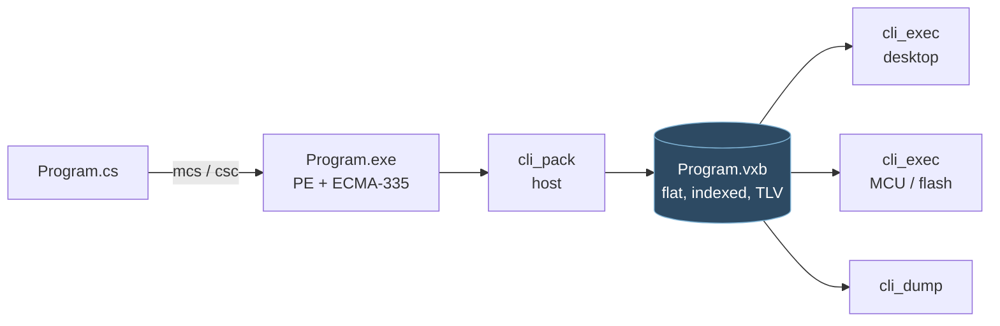
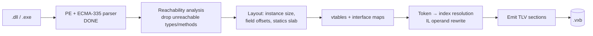
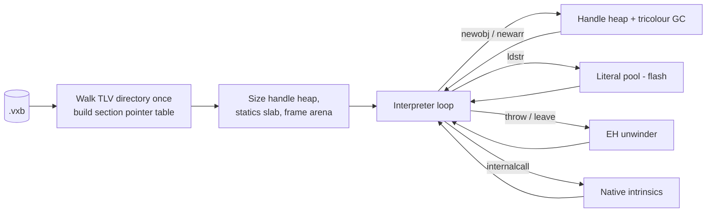
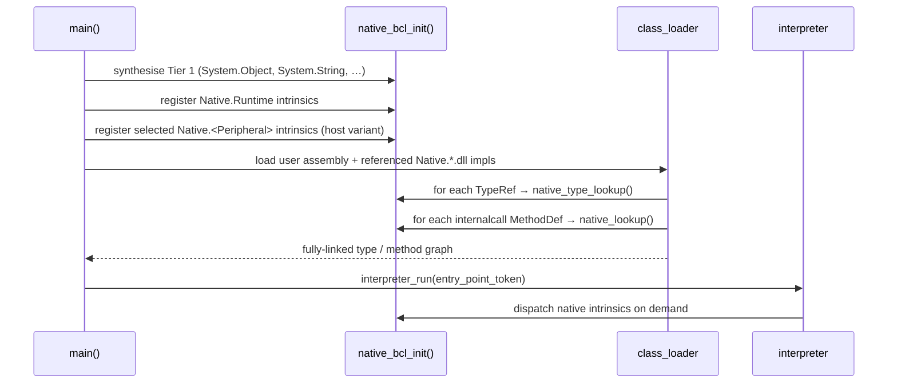

# Building an IL Virtual Execution Engine — Introduction

This document introduces the work required to turn the current **ECMA-335
metadata parser** into a **virtual execution engine (VEE)** that runs a .NET
assembly by **interpreting CIL/IL bytecode** — no JIT, no native code
emission.

> **Where the work stands and what comes next:**
> [19_Session_Checklist.md](19_Session_Checklist.md). Read it first in every
> session.

## Architecture — three tools, one format

The project is split into a **host-side toolchain** and a **portable
executor**, joined by a purpose-built binary image format (`.vxb`).
Nothing on the execution side ever reads a PE file or an ECMA-335 metadata
stream.

| Tool        | Runs on              | Reads          | Writes | Role                                                                                                     |
|-------------|----------------------|----------------|--------|----------------------------------------------------------------------------------------------------------|
| **`cli_pack`** | host only         | `.dll` / `.exe`| `.vxb` | Parse ECMA-335, run reachability analysis, resolve every token to a direct index, compute layouts and vtables, emit the flat image. |
| **`cli_exec`** | host **and** MCU  | `.vxb`         | —      | Load the image, size the handle heap and frame arena, interpret IL.                                      |
| **`cli_dump`** | host only         | `.vxb`         | text   | Human-readable dump of an image. Shares `cli_exec`'s reader so the two can never disagree.               |



### Why the split

- **The device never parses metadata.** No PE headers, no `#~`/`#Strings`/
  `#Blob` heaps, no coded indices, no compressed integers, no token
  resolution, no assembly search paths. All of it happens once, on a laptop.
- **Token resolution becomes an array index.** `cli_pack` rewrites IL
  operands in place — `call 0x0A000012` (a `MemberRef` token) becomes
  `call 0x0042` (a direct index into `methods[]`). This removes the single
  largest cost from the interpreter's hot path.
- **Most of the image is read-only and can stay in flash.** Type
  descriptors, vtables, interface maps, IL code, EH tables and string
  literals are executed in place (XIP); only mutable static fields and the
  heap consume RAM. A PE file cannot be used this way.
- **Unreachable code is dropped at pack time**, which on a
  flash-constrained part is frequently the difference between fitting and
  not.
- **One execution path.** The desktop build runs the *same bytes* the MCU
  would. `cli_exec` never learns to read a `.dll`, so the two targets cannot
  drift apart.

This is the design .NET Micro Framework and nanoFramework converged on: a
host-side metadata processor feeding a compact device format.

The existing 7,000-line parser is not discarded by this split — it *becomes*
`cli_pack`'s front end, where its linked lists and `malloc` are perfectly
acceptable because it runs on a host.

---

## 1. What already exists

The current codebase ends at the "loaded and decoded" stage — it produces an
in-memory representation of everything the runtime needs, but does not yet
execute anything. **All of it belongs to `cli_pack`.**

### 1.1 Parser layers (working — `cli_pack` front end)

| Layer                | Files                                                                                 | Purpose                                                                 |
|----------------------|---------------------------------------------------------------------------------------|-------------------------------------------------------------------------|
| PE loader            | [pe_parser.c](../source/pe_parser.c), [pe_parser.h](../source/pe_parser.h)            | DOS/PE/COFF headers, CLR header (COM descriptor), RVA→file translation. |
| Metadata root        | [ecma_335_parser.c](../source/ecma_335_parser.c)                                      | `BSJB` signature, streams `#~`, `#Strings`, `#Blob`, `#GUID`, `#US`.    |
| Table dispatcher     | [metadata_table.c](../source/metadata_table.c)                                        | Row iterator, coded-index sizing, compressed-int decoding.              |
| Row decoders (×27)   | [source/row_table/](../source/row_table)                                              | One `<table>_table.c` per implemented metadata table.                   |
| Signature decoder    | [signature_parser.c](../source/methods/signature_parser.c)                            | `Type`, method sig, field sig, `LOCAL_SIG`, `MemberRef` sig.            |
| Method body reader   | [method_parser.c](../source/methods/method_parser.c)                                  | Tiny/Fat headers, `local_var_sig_tok`, IL bytes.                        |
| Cross-table linking  | [typedef_parser.c](../source/methods/typedef_parser.c), `member_ref_parser.c`, ...    | Field/Method → TypeDef; MemberRef → parent.                             |
| Framework primitives | [source/framework/](../source/framework)                                              | Pool allocator (working), stack + object + exception + arch (stubs).    |

### 1.2 Metadata tables — decoder status

**All 35 spec-defined tables are implemented.** See
[99_phase0_work.md](99_phase0_work.md) for the completion record.

`Module (0x00)`, `TypeRef (0x01)`, `TypeDef (0x02)`, `Field (0x04)`,
`MethodDef (0x06)`, `Param (0x08)`, `InterfaceImpl (0x09)`,
`MemberRef (0x0A)`, `Constant (0x0B)`, `CustomAttribute (0x0C)`,
`FieldMarshal (0x0D)`, `DeclSecurity (0x0E)`, `ClassLayout (0x0F)`,
`FieldLayout (0x10)`, `StandAloneSig (0x11)`, `EventMap (0x12)`,
`Event (0x14)`, `PropertyMap (0x15)`, `Property (0x17)`,
`MethodSemantics (0x18)`, `MethodImpl (0x19)`, `ModuleRef (0x1A)`,
`TypeSpec (0x1B)`, `ImplMap (0x1C)`, `FieldRVA (0x1D)`,
`Assembly (0x20)`, `AssemblyRef (0x23)`, `File (0x26)`,
`ExportedType (0x27)`, `ManifestResource (0x28)`, `NestedClass (0x29)`,
`GenericParam (0x2A)`, `MethodSpec (0x2B)`,
`GenericParamConstraint (0x2C)`.

Not implemented, and not required: the Edit-and-Continue tables
(`ENCLog 0x1E`, `ENCMap 0x1F`) and the obsolete processor/OS assembly
tables (`0x21`, `0x22`, `0x24`, `0x25`). None appear in real assemblies.

Method bodies are fully decoded including **exception-handling clauses**
(small and fat section formats, chained) — see
[method_parser.c](../source/methods/method_parser.c).

### 1.3 Framework primitives — status

These belong to **`cli_exec`** and are the starting point for Slice A.

| Module                                                                                        | State        | Note                                                                    |
|-----------------------------------------------------------------------------------------------|--------------|-------------------------------------------------------------------------|
| [pool.c](../source/framework/pool.c)                                                          | Complete     | Fixed-size block allocator — candidate substrate for the heap's size classes. |
| [critical_section.c](../source/framework/critical_section.c)                                  | Complete     | Reentrancy guard.                                                       |
| [stack.h](../source/framework/stack.h), [stack.c](../source/framework/stack.c)                | **Stub**     | `stack_push/pop/peek_at` are empty. Slot format to be re-sized before Slice A — see [11_Memory_Model.md](11_Memory_Model.md). |
| [objects.h](../source/framework/objects.h), [objects.c](../source/framework/objects.c)        | **Stub**     | `objects.c` is empty; superseded by the handle-heap design.             |
| [exception.h](../source/framework/exception.h)                                                | **Stub**     | `DO_ASSERT` disabled; will host managed-exception unwind.               |
| [arch.h](../source/framework/arch.h)                                                          | Skeleton     | `n_ptr_t`, `HEAP_ATTR`, `FRAME_ATTR` — hooks for a target port.         |

---

## 2. Target execution model

We follow **ECMA-335 Partition I §12** (Common Language Infrastructure —
Execution Model) and **Partition III** (CIL Instruction Set) literally, without
any JIT step. The work is divided across the pack/exec boundary.

### 2.1 Stage 1 — `cli_pack` (host)



Everything expensive happens here: coded-index decoding, signature parsing,
layout computation, vtable construction, generic monomorphisation, and the
IL operand rewrite. The output is flat, indexed, and 4-byte aligned.

### 2.2 Stage 2 — `cli_exec` (host or MCU)



Load is O(number of sections), not O(size of image): the executor walks the
TLV chain once to build a `section_ptr[kind]` lookup table, then indexes
flat arrays for the rest of the run.

The interpreter is a classic `while (running) { opcode = *ip++; switch(opcode)
{ ... } }` loop over a per-method **activation frame** containing:

- argument slots (`this` + declared params, promoted to stack-native widths),
- local slots (zero-initialised when `CorILMethod_InitLocals` is set),
- an evaluation stack sized by `MaxStack`,
- a saved IP and a return slot,
- a link to the enclosing exception-handler chain.

Each **evaluation-stack slot** is a tagged union — required because CIL is not
statically typed at the byte level (§III.1.1 "types on the evaluation stack":
`int32`, `int64`, `native int`, `F` (float), `O` (object ref), `&` (managed
pointer)). The tag is what makes the GC precise over the evaluation stack at
zero cost — see [11_Memory_Model.md](11_Memory_Model.md).

**Object references are handles, not pointers.** Every `O` slot holds an
`object_id_t` — a 32-bit value carrying a *space* tag and an index — and the
executor resolves it to an address only for the duration of a single opcode.
For collectable spaces the index selects a handle-table slot, so heap
compaction is a rewrite of the handle table alone, with no pointer fixup
anywhere in the heap, on the stack, or in native code. See
[14_ObjectHandler.md](14_ObjectHandler.md).

---

## 3. Gap analysis — what still has to be built

Grouped by subsystem. Order roughly matches the recommended implementation
sequence.

### 3.1 Loader completion — **complete**

All eight missing table decoders and the EH-clause section parser were
delivered in Phase 0; see [99_phase0_work.md](99_phase0_work.md).

Two items from the original list moved into `cli_pack`'s emitter rather than
the parser, because under the two-binary split they are pack-time concerns:

1. **`#US` (user-string) heap accessor.** `cli_pack` walks every reachable
   `ldstr` operand, builds the literal pool as a `.vxb` section, and rewrites
   each operand to a pool index. The executor never sees the `#US` heap.
2. **`FieldRVA` payloads.** `cli_pack` copies the referenced bytes into the
   image's static-data section so `RuntimeHelpers.InitializeArray` becomes a
   `memcpy` from flash, with no RVA translation on the device.

Still outstanding in the parser, and now the main known gap:

- **PE32+ support.** [pe_parser.c](../source/pe_parser.c) accepts only
  `0x10B` (PE32) and rejects `0x20B`. Mono's `mcs` emits PE32, so this does
  not block bring-up, but any assembly produced by a modern .NET SDK will be
  rejected. Needed before `cli_pack` can consume arbitrary real-world input.

### 3.2 Class / type system

All of this is **`cli_pack`'s work**, computed once on the host and emitted
as flat tables. The executor consumes the results; it never computes a
layout or builds a vtable.

Detailed background lives in
[Virtual_Method_Tables.md](../docs-archive/Virtual_Method_Tables.md) and
[TypeDef_Method_Traversal.md](../docs-archive/TypeDef_Method_Traversal.md).

1. **Instance layout computer.** For each `TypeDef`, compute:
   - total instance size (auto-layout from field signatures; explicit layout
     from `ClassLayout` + `FieldLayout`),
   - per-field offset table,
   - packing / alignment rules (`ClassLayout.PackingSize`).
2. **Static field storage.** Allocate one slab per type for `static` fields;
   initialise on first use by invoking the type's `.cctor` (lazy class init).
3. **vtable builder.** As described in the archive: copy parent vtable, replace
   slots for `virtual` methods that are **not** `newslot`, append new slots
   for `virtual newslot`. Store on a `method_table_t` referenced from every
   object header.
4. **Interface dispatch table.** For each interface a type implements
   (`InterfaceImpl`), store a mapping `iface_slot → concrete_method` so
   `callvirt` on an interface method is O(1).
5. **Token resolution — moved to `cli_pack`.** There is no runtime token
   resolver. `cli_pack` resolves every `TypeDef`/`TypeRef`/`MemberRef`/
   `MethodDef`/`Field`/`TypeSpec`/`MethodSpec` token exactly once and
   **rewrites the IL operand in place** to a direct index:
   `call 0x0A000012` → `call 0x0042`. Likewise `ldfld` becomes a byte
   offset and `ldstr` a literal-pool index. `cli_exec`'s `call` handler is
   therefore `methods[operand]` — one array index, no metadata walk.

   This also retires
   [`metadata_table_get_row_data_by_index`](../source/metadata_table.c),
   which walks a linked list from the head on every call — O(rows) per
   lookup, roughly 800 pointer chases per token against a 1,638-row
   `MethodDef` table. Acceptable in a host-side packer; fatal in an
   interpreter loop.
6. **Generics — monomorphise at pack time.** Rather than substituting
   `VAR`/`MVAR` at runtime, `cli_pack` expands each distinct instantiation
   into a concrete type (`List<int>` becomes its own entry in `types[]`).
   The executor then has no generics subsystem at all — more emitter work,
   far less device code and RAM. Limitation: this cannot express
   instantiations created reflectively, which is one more reason reflection
   is excluded from the device target.

### 3.3 Managed heap and object model

The skeletons in [objects.h](../source/framework/objects.h) are superseded by
**ObjectHandler**, a standalone library that owns objects, the heap, the
per-thread stack and the collector, decomposed one module per responsibility
— `objects_`, `heap_`, `stack_`, `obj_string_`, `value_`, `array_`, `gc_`. Full
specification in [14_ObjectHandler.md](14_ObjectHandler.md); the policy that
surrounds it is in [11_Memory_Model.md](11_Memory_Model.md). Summary here.

1. **References are tagged object ids, not pointers.** An object reference is
   an `object_id_t`: 16 bits of *space* saying which region owns the object,
   and 16 bits of index within it. Collectable spaces index a handle table;
   the image's constant pool, the statics slab, frame scratch and foreign
   memory index themselves directly. One reference type designates an object
   wherever it lives, and "is this collectable?" is one compare.
2. **The heap stays 16-bit, deliberately.** A segment is at most 64 KB
   because that is the size that fits the target and it halves every stored
   offset. The id can address 16 segments, but v1 uses one on every target,
   MCU and host alike.
3. **Compaction is free of fixups, and deferred past v1.** Because references
   stored *inside* objects are themselves object ids, sliding a live object
   only requires rewriting its handle-table entry. That is what makes it safe
   to leave out of the first release and add later on measurement.
4. **Indirection is paid once per opcode, not per access.** The GC runs only
   at safepoints *between* opcodes, so a handler resolves the reference to an
   address once and uses it freely until the next dispatch.
5. **Interior pointers are pairs.** `ldflda`, `ldelema` and `ldloca` produce
   ECMA's `&` type, represented as `{ object_id_t id; uint16_t offset; }`.
   One byref kind suffices, because the space tag already says which region
   is meant.
6. **Most short-lived allocation never reaches the heap.** Typed stack slots
   mean primitives never box; non-escaping `box` sites and temporary value
   types allocate in a per-frame scratch arena released by `ret` in a single
   store; and what does reach the heap hits a size-class recycler first. A
   promoting write barrier makes the scratch tier safe regardless of how good
   the pack-time escape analysis is.
7. **Collector.** Tricolour mark-sweep, **precise**, **non-moving initially**,
   stop-the-world, triggered at 75 % heap occupancy rather than at allocation
   failure, with the mark bit in the handle and a bounded, pre-allocated grey
   worklist. Precision is nearly free: the evaluation stack is already
   type-tagged, and `cli_pack` emits reference bitmaps for instance fields,
   statics, and each method's locals/args.
8. **String and array layout is owned by C**, because the interpreter and
   the collector must agree on it byte-for-byte. `System.String` is a
   length-prefixed UTF-16 payload; `SZARRAY` is length plus elements.
   Boxing allocates an object whose payload copies the value.

### 3.4 The interpreter core

1. **Evaluation stack — implementation of [stack.c](../source/framework/stack.c).**
   Replace the empty function bodies. The existing `stack_node_t` carries
   16 bytes of payload where IL needs at most 8; re-size it before Slice A
   locks it in. Target shape: `{ uint8_t kind; uint8_t flags; uint16_t aux;
   union { int32_t i4; int64_t i8; double r8; object_id_t id; } }`.
   The `kind` tag is mandatory — it is what makes GC scanning of the
   evaluation stack precise without stack maps. See
   [14_ObjectHandler.md §6](14_ObjectHandler.md).
2. **Activation frame.** One record per active call, carved from a
   pre-allocated per-thread region rather than `malloc`, chained via `prev`.
   Frames live on their own stack beside the value stack, so a call passes
   arguments by pointing the callee's argument window at the caller's top
   evaluation slots — no copying, whatever the argument count. Sizing comes
   from the image header, so the device performs no dynamic allocation for
   frames.
3. **Dispatch table.** A `void * op_handlers[256]` (plus a second table for
   `0xFE xx` opcodes) works for computed-goto builds; a plain `switch` is
   equally fine and more portable.
4. **Opcode handlers.** Roughly 220 opcodes total; group them:
   - **Load/store/dup/pop** — `ldarg*`, `ldloc*`, `starg*`, `stloc*`, `dup`,
     `pop`, `ldc.*`, `ldnull`, `ldstr`, `ldtoken`.
   - **Arithmetic & logic** — `add`, `sub`, `mul`, `div`, `rem`, `neg`,
     `and`, `or`, `xor`, `shl`, `shr[.un]`, `not`, `*.ovf[.un]`.
   - **Conversions** — `conv.*` and `conv.ovf.*[.un]` (30+ opcodes).
   - **Compare & branch** — `ceq`, `cgt[.un]`, `clt[.un]`, `br[.s]`,
     `brfalse/brtrue[.s]`, `beq/bne/bge/bgt/ble/blt[.s][.un]`, `switch`.
   - **Method dispatch** — `call`, `callvirt`, `calli`, `newobj`, `ret`,
     `jmp`, `ldftn`, `ldvirtftn`.
   - **Fields** — `ldfld`, `ldflda`, `stfld`, `ldsfld`, `ldsflda`, `stsfld`.
   - **Objects & arrays** — `newarr`, `ldlen`, `ldelem*`, `stelem*`,
     `ldelema`, `box`, `unbox[.any]`, `castclass`, `isinst`,
     `initobj`, `ldobj`, `stobj`, `cpobj`.
   - **Indirect access** — `ldind.*`, `stind.*`, `cpblk`, `initblk`,
     `localloc`.
   - **Exceptions** — `throw`, `rethrow`, `leave[.s]`, `endfinally`,
     `endfilter`.
   - **Prefixes** — `unaligned.`, `volatile.`, `tail.`, `constrained.`,
     `readonly.`, `no.` (mostly ignorable for a correctness-first
     interpreter, but the prefix bytes must be consumed).
5. **Stack-slot type coercion.** Enforce §III.1.5: `int8/int16/bool/char`
   are promoted to `int32` on the stack; `float32` is promoted to `F`
   (machine-choice precision). Do the widening in the load opcode, the
   narrowing in the store opcode.

### 3.5 Exception handling

The clauses are already parsed (§3.1) and `cli_pack` emits them as a flat
`eh[]` section with offsets relative to each method's code, so the executor
reads them as a plain array:

1. On `throw`, walk up the frame chain looking for an enclosing `catch`
   whose class matches (via runtime `isinst`) or a `filter` that evaluates
   truthy. `finally`/`fault` clauses on the way are executed and then
   `endfinally` resumes the walk.
2. `leave` from a protected region runs all pending `finally` blocks in
   reverse and then transfers to the target IP.
3. Clause order is preserved from the metadata — innermost first, per
   §II.19.5 — so the unwinder takes the first match without sorting.
4. Catch-type operands are rewritten by `cli_pack` from metadata tokens to
   direct `types[]` indices, so the match is an index comparison walking the
   parent chain, not a token resolution.
5. Reuse the existing `exception.h` `KERNEL_TRY`/`KERNEL_RAISE_ERROR` hooks
   so the **host** can also longjmp out of a runaway interpreter.

### 3.6 Bridge to the outside world

You cannot execute any real assembly without at least a handful of BCL
methods. Two mechanisms:

1. **Internal calls (intrinsics).** Methods flagged `internalcall` bind to C
   functions. `cli_pack` resolves the binding by name at pack time and emits
   a small **binding id** in the method record; the executor dispatches
   through `intrinsics[id]` with no string comparison at runtime. The
   name-keyed table exists only on the host.
2. **P/Invoke** via `ImplMap`: `dlopen`/`GetProcAddress` the target library
   and marshal arguments per `FieldMarshal`. Host target only — on an MCU
   target there is no dynamic loader, and native calls are resolved at link
   time instead.

These are only the entry points. The full architecture — how the C side
declares its intrinsics, how the mandatory `System.*` floor is satisfied
without shipping a desktop-scale BCL, how per-peripheral `Native.*`
assemblies are structured as reference/implementation pairs so the same
user binary runs against a host build or (as future work) against
an STM32H7 HAL, and how the GC and the native code negotiate object
lifetimes — is developed in **§6 (External native APIs — the `Native.*`
assembly family)**.

### 3.7 Bootstrap

Split across the two binaries. `cli_pack` records the entry method's index
in the image header, so the executor never resolves a token.

```text
cli_pack  Program.exe -o Program.vxb
├── pe_parser + ecma_335_parser                (done)
├── reachability walk from entry_point_token   (§3.2)
├── compute layouts, statics slab, vtables     (§3.2)
├── monomorphise generic instantiations        (§3.2.6)
├── rewrite IL operands: token → index         (§3.2.5)
├── build literal pool + reference bitmaps     (§3.3)
└── emit TLV sections, entry index in header

cli_exec  Program.vxb
├── validate magic + format_version + required sections
├── walk TLV directory → section_ptr[kind]
├── reserve statics slab, handle table, heap, frame arena
├── zero statics; run reachable .cctors        (§3.2)
├── frame = frame_new(header.entry_method)
├── if entry takes string[]: build managed string[] from argv
├── interpreter_run(frame)                     (§3.4)
└── return frame->return_value.i4
```

Every allocation in the executor's startup path is sized from the image
header. On an MCU target the four regions can be static arrays, so the
device performs no dynamic allocation before `main` — and the read-only
sections are read directly from flash rather than copied.

---

## 4. Recommended plan — vertical slices

**Phase 0 (parser completion) is done.** What follows replaces the original
horizontal phase plan with vertical slices: each slice is a `.vxb` format
version bump plus matching emitter and executor features, and each ends in a
program that actually runs. Both sides grow together, so they stay in sync by
construction.

| Slice | `cli_pack` adds                                                                                  | `cli_exec` adds                                                                                     | Milestone                          |
|-------|---------------------------------------------------------------------------------------------------|------------------------------------------------------------------------------------------------------|------------------------------------|
| **A** | header + TLV directory, `types[]` (size/parent), `methods[]`, `code[]`, token→index rewrite for `call` | image loader, frame arena, eval stack ([stack.c](../source/framework/stack.c)), ~20 opcodes: `ldc.i4*`, `ldloc`/`stloc`, `ldarg`, `add`/`sub`/`mul`, `br*`, `ret`, static `call` | `fib(20)` returns 6765             |
| **B** | field layout, statics slab + reference bitmaps, vtables, interface map, `ldfld`/`stfld` offset rewrite | `newobj`, `ldfld`/`stfld`, `callvirt`, statics, `.cctor`, bump allocator (no collection yet)          | virtual override dispatches correctly |
| **C** | string literal pool, `bindings[]`, `ldstr` index rewrite                                          | handle heap + tricolour STW GC, `native_bcl` registration/lookup, `System.String`/`System.Array`, `ldstr` | **Hello, World**                   |
| **D** | `eh[]` section (clauses already parsed)                                                          | unwind walk, `throw`, `rethrow`, `leave`, `endfinally`, `endfilter`                                  | `try/catch/finally`                |
| **E** | generic monomorphisation, remaining operand rewrites                                             | arrays, boxing, conversions, compares, `switch`                                                      | `List<int>`-shaped code            |

`cli_dump` is built during Slice A, not later — debugging a binary format
without a dumper is impractical, and a dump shaped like disassembler output
lets the emitter be validated by diffing against `monodis`/`ildasm`.

### 4.1 Definition of done

> A C# program compiled with `mcs`, packed by `cli_pack`, runs under
> `cli_exec` and produces correct output — using objects, virtual dispatch,
> strings, arrays and `try/catch` — with the **same `.vxb` bytes** executing
> on the desktop and on an MCU-class target.

Peripheral assemblies (§6.3), the `nativegen` ref-assembly generator, and
ahead-of-time compilation all come *after* that line. See
[10_Native_Assembly_Layout.md](10_Native_Assembly_Layout.md) §§4–8, which are
deferred until this milestone is met.

### 4.2 Prerequisites

| Item | Status |
|---|---|
| Version control | done |
| Toolchain for test fixtures (`mono-devel` → `mcs` + `ilasm`) | required before the emitter can be tested against real input; Slice A's executor can be bootstrapped from a hand-authored `.vxb` without it |
| Capability matrix (generics / reflection / float / threading decisions) | must precede the format spec — determines which sections ever exist |

---

## 5. Reference material inside the repo

| Topic                          | Document                                                                 |
|--------------------------------|--------------------------------------------------------------------------|
| Adding a new table decoder     | [docs-archive/Adding_Table_Decoder.md](../docs-archive/Adding_Table_Decoder.md) |
| A worked table example         | [docs-archive/Module_Table_Definition.md](../docs-archive/Module_Table_Definition.md) |
| Signature blob format          | [docs-archive/Signature_Decoding.md](../docs-archive/Signature_Decoding.md), [docs-archive/signature_draft.md](../docs-archive/signature_draft.md) |
| Navigating decoded types       | [docs-archive/Navigating_Decoded_Types.md](../docs-archive/Navigating_Decoded_Types.md) |
| Method body & type traversal   | [docs-archive/TypeDef_Method_Traversal.md](../docs-archive/TypeDef_Method_Traversal.md) |
| vtable construction & dispatch | [docs-archive/Virtual_Method_Tables.md](../docs-archive/Virtual_Method_Tables.md) |
| Pool allocator API             | [docs-archive/Pool_Allocator.md](../docs-archive/Pool_Allocator.md)      |
| Full CLI spec                  | `docs-archive/ECMA-335_6th_edition_june_2012.pdf`                        |

Suggested reading in the ECMA-335 spec for the execution work:

- **Partition I §8–§12** — Common Type System and execution model.
- **Partition II §22–§25** — Metadata physical layout (already implemented).
- **Partition III §1–§4** — CIL instruction semantics (the interpreter core).
- **Partition III §1.5** — Types on the evaluation stack.
- **Partition II §25.4** — Method header and exception-clause encoding.

---

## 6. External native APIs — the `Native.*` assembly family

The .NET Base Class Library exists in two very different tiers as far as
this VEE is concerned:

**Tier 1 — the mandatory `System.*` floor.**
The C# compiler *requires* a fixed set of types before it will emit any
IL at all: `System.Object`, `System.ValueType`, `System.Enum`,
`System.Void`, every primitive from `System.Int32` through `System.Double`,
`System.String`, `System.Array`, `System.Delegate`,
`System.MulticastDelegate`, `System.Type`,
`System.Runtime{Type,Field,Method}Handle`, `System.Attribute` plus a
handful of well-known attributes, `System.Exception`, and
`System.Runtime.CompilerServices.RuntimeHelpers`. Every method signature
refers to at least `System.Void`, every reference type inherits
`System.Object`, every string literal materialises a `System.String`, and
any `throw` expression targets `System.Exception`. This tier is
non-negotiable.

**Tier 2 — the "real" API surface.**
Everything the *program* actually calls: hardware peripherals on the
microcontroller, OS services on the host target, higher-level
utilities like `Math` or `Buffer`. On CoreCLR this tier is bundled into
the same `System.Private.CoreLib.dll` as Tier 1; on this VEE it is split
into a family of small `Native.*` assemblies. `System.IO.File`,
`System.Console`, `System.Threading.Thread`, and the rest of the
desktop-flavoured `System.*` API are *deliberately absent* — a
microcontroller has GPIO and I²C, not a filesystem full of files or a
threading model with cooperative scheduling.

The design goals for this section are therefore:

1. Satisfy Tier 1 with the smallest possible amount of code, all backed
   by C. No IL is decoded for `System.Object..ctor`, `System.String`
   accessors, or any other Tier 1 method.
2. Expose Tier 2 through explicit, per-peripheral `Native.*` assemblies
   so embedded users see one assembly per bus/peripheral and can pick
   exactly what they need.
3. Ship every Tier 2 assembly as a **ref/impl pair** so the same C#
   binary runs unchanged against a host build (impl calls
   stdio / stubs) and — as a follow-up project — against an STM32H7
   target (impl calls the STM32Cube HAL).
4. Allow the parser to **synthesise the Tier 1 floor internally** when
   no `Native.CoreLib.dll` is present on disk, so the earliest test
   cases can run with zero managed dependencies.

The rest of this section reviews the architectural options, evaluates
the alternatives, and recommends a concrete design. A full walkthrough
of the assembly matrix, the ref-assembly auto-generator, the
per-peripheral host behaviour, and the deferred STM32H7 work lives
in the companion document
[10_Native_Assembly_Layout.md](10_Native_Assembly_Layout.md).

### 6.1 Four architectural options

**Option A — Per-method intrinsics** (the CoreCLR *InternalCall* / *FCall* /
*QCall* model).
The managed side declares a normal method with an empty body and the
`InternalCall` implementation flag (§II.23.1.11:
`MethodImpl.ImplFlags & 0x1000`). At load time the runtime looks up the
method in a `name → C-function` table and stores the C pointer on the
`method_info_t`. IL is never decoded for that method.

- *Pros* — fine-grained; standard, well-understood contract; the same
  managed assembly runs on CoreCLR and on our VEE without changes.
- *Cons* — the managed metadata still has to exist and be loaded.

**Option B — Whole-type substitution / parser-synthesised types**
("native class descriptor").
Selected type references resolve to a **C-defined class descriptor**
instead of a managed `TypeDef`. Layout, vtable, and every method body
live entirely in C. In this codebase Option B has a second use: the
parser can synthesise the mandatory Tier 1 floor purely in C, so the
interpreter starts up correctly *even when no `Native.CoreLib.dll` is
present on disk* — invaluable for unit tests and self-hosting bring-up.

- *Pros* — fastest possible; no metadata cost per method; layout fully
  under C's control (critical for `Object`, `String`, `Array` where the
  GC and the interpreter both need exact field positions); works with
  zero managed dependencies.
- *Cons* — reflection surface is diminished; managed code cannot
  subclass or override these types cleanly; each substituted type has
  to be hand-written.

**Option C — Facade / stub assembly.**
Ship a tiny assembly (`Native.CoreLib.dll`, `Native.Gpio.dll`, …) where
every method is marked `internalcall` and the class hierarchy mirrors
the target API. The interpreter always finds metadata to bind against;
the C table provides all the code.

- *Pros* — clean separation; can be autogenerated from the C
  registration table; reflection over the API surface still works.
- *Cons* — build-time step to produce the stub; slightly more metadata
  to parse at startup.

**Option D — Reference/implementation split** (the .NET Core pattern).
For each Tier 2 assembly ship **two** variants: a *ref assembly*
(`ref/Native.Gpio.dll`) with empty bodies used at `csc /r` compile time,
and one or more *impl assemblies*
(`impl/host/Native.Gpio.dll`, `impl/stm32h7/Native.Gpio.dll`) loaded by
the VEE at run time. Both variants publish the same `MethodDef` rows;
only the C bindings behind the `internalcall`s differ.

- *Pros* — the same user binary runs unchanged against the host and
  STM32H7 HAL impls; ref assemblies can be autogenerated
  from a C header describing the peripheral surface.
- *Cons* — two DLLs per API to build and version.

### 6.2 Recommended design — hybrid B + C + D layered on A

| Layer                                             | Strategy      | Assembly / types                                                                                        |
|---------------------------------------------------|---------------|--------------------------------------------------------------------------------------------------------|
| Tier 1 mandatory floor (compile-time requirement) | **B**         | `System.Object`, `System.ValueType`, `System.Enum`, primitives, `System.String`, `System.Array`, `System.Delegate`, `System.Exception`, `System.Type`, well-known attributes. Parser-synthesised in C by default; a `Native.CoreLib.dll` shim may add reflection metadata for the same types when loaded. |
| Tier 2 runtime services (target-independent)      | **A + C**     | `Native.Runtime` — GC hints, timing, `RuntimeHelpers.InitializeArray`, reboot/halt.                    |
| Tier 2 hardware surface (target-dependent)        | **A + C + D** | `Native.Gpio`, `Native.I2c`, `Native.Spi`, `Native.Adc`, `Native.Pwm`, `Native.Uart`, `Native.Timer`. Ref for `csc /r`; host + (future) STM32H7 impls behind identical stubs. |
| Convenience wrappers                              | **C + IL**    | `Native.Console` = thin IL over `Native.Uart` (target) or `Native.Runtime.HostIo` (host).               |
| Everything else                                   | pure IL       | User libraries; managed helpers that never touch hardware.                                             |

Rationale:

- **B** is unavoidable for the Tier 1 floor: nothing else can allocate
  a `System.String` because the interpreter and GC must agree on its
  exact layout. Parser-synthesised descriptors also make Tier 1
  available *before* any assembly is loaded, which is a hard bootstrap
  requirement.
- **C** provides the metadata anchor for Tier 2 without hand-writing
  stub metadata for every method — one generator emits ref assemblies
  from a C header.
- **D** decouples "what the compiler sees" from "what runs on the
  target", which is exactly the host ↔ STM32H7 story the
  project is chasing.
- **A** is the calling convention every intrinsic obeys once bound,
  regardless of tier. There is only one binding API in
  `framework/native_bcl.h`.

### 6.3 The `Native.*` assembly family

| Assembly          | Purpose                                                                                | Ref assembly? | Host impl                    | STM32H7 impl (future)             |
|-------------------|----------------------------------------------------------------------------------------|---------------|-----------------------------------|-----------------------------------|
| `Native.CoreLib`  | Optional reflection shim over the Tier 1 parser-synthesised floor. All methods `internalcall`; the C bindings are the same functions the parser installs when synthesising the types from thin air. | No — always identical  | Loaded only when reflection over `System.*` is needed | Same                              |
| `Native.Runtime`  | Cross-cutting VEE services: `RuntimeHelpers.InitializeArray`, timing, GC hints, reboot/halt, host I/O for the host. | Yes           | `clock_gettime`, `atexit`, `stdin`/`stdout` | `HAL_GetTick`, `NVIC_SystemReset` |
| `Native.Gpio`     | Digital pin read/write, pin mode, edge callbacks.                                      | Yes           | stdout logger                     | `HAL_GPIO_*`                      |
| `Native.I2c`      | I²C master transactions.                                                               | Yes           | scripted-response table           | `HAL_I2C_Master_*`                |
| `Native.Spi`      | SPI full-duplex transfers.                                                             | Yes           | loopback                          | `HAL_SPI_TransmitReceive`         |
| `Native.Uart`     | Blocking + async UART read/write.                                                      | Yes           | host stdin/stdout                 | `HAL_UART_*`                      |
| `Native.Adc`      | Single-shot + continuous ADC reads.                                                    | Yes           | ramp / recorded-CSV               | `HAL_ADC_*`                       |
| `Native.Pwm`      | PWM channel config + duty cycle.                                                       | Yes           | logger                            | `HAL_TIM_PWM_*`                   |
| `Native.Timer`    | Software timers, periodic callbacks.                                                   | Yes           | pthread-based                     | `HAL_TIM_Base_*` + NVIC IRQ       |
| `Native.Console`  | Convenience `WriteLine` / `Write` / `ReadLine` over `Native.Uart` or `Native.Runtime.HostIo`. Pure IL, no `internalcall`. | Yes           | Yes                               | Yes                               |

Naming rule: every assembly whose implementation is (partly or wholly)
provided by C uses the `Native.` prefix. The `System.*` namespace is
reserved for Tier 1 only, and even then the parser-side descriptors are
authoritative — the on-disk `Native.CoreLib.dll` is an *additive*
reflection layer, never a replacement.

### 6.4 Reference/implementation split

Every Tier 2 `Native.*` assembly ships as:

- One **ref assembly** at `ref/Native.<Peripheral>.dll`.
  Full metadata, empty method bodies (`throw null;`). Used by `csc /r`
  when the user builds their C# program. Auto-generated from a C
  header — see [10_Native_Assembly_Layout.md](10_Native_Assembly_Layout.md).
- One or more **impl assemblies** at
  `impl/<target>/Native.<Peripheral>.dll`. Same public metadata; every
  method body is `internalcall`. Different `<target>` directories
  (`host/`, `stm32h7/`, …) share the same managed metadata but bind to
  different C libraries.

At runtime the VEE loads *one* impl variant per assembly. The choice is
a launch flag on the host target and a compile-time constant on
embedded targets. `AssemblyRef` rows in the user assembly refer to the
ref assembly's identity (name, version, public-key token); the loader
resolves them to the currently selected impl.

### 6.5 In scope: host target. Future project: STM32H7 target

> **Terminology — "host", not "simulator".** The host build is *not* a
> simulator: nothing emulates a target CPU, its memory map, or its
> peripheral registers. It is the **same C source compiled natively for
> the developer's computer**, with the `Native.*` bindings resolved to
> OS services instead of a HAL. `host` is therefore a target alongside
> `stm32h7` and `esp32`, not a synthetic machine. The one place the word
> "emulate" would be correct is a future QEMU harness, which is out of
> scope.

**In scope — host target (`host/` impls).**
The VEE runs as a normal desktop process. Every `Native.<Peripheral>.dll`
has a `host/` impl that maps peripheral operations onto host services:

- `Native.Gpio` writes → stdout log lines like `[GPIO] PA5 = HIGH`.
- `Native.Uart` reads/writes → stdin/stdout of the host process.
- `Native.I2c` / `Native.Spi` → scriptable transaction tables loaded
  from a JSON file at boot, so tests can pre-record slave responses.
- `Native.Adc` → ramp / sine / recorded-CSV generator.
- `Native.Timer` → pthread-based periodic callbacks.

This is enough to exercise almost all embedded application logic
without any hardware in the loop. It is the only impl variant this
repository ships, and it is built **after** the §4.1 definition of done —
see [10_Native_Assembly_Layout.md](10_Native_Assembly_Layout.md) §§4–8,
which are deferred. Slice C builds only the binding infrastructure plus
the single `Native.Console` path needed for "Hello, World".

**Out of scope, deferred to a follow-up project — STM32H7 target
(`stm32h7/` impls + AOT).**
The same C# binary flashed to an STM32H7 board runs against `stm32h7/`
impls that call the STM32Cube HAL directly. Two additional layers are
required in that future project and are *not* part of the current
roadmap:

1. **AOT compilation.** Interpretation is too slow for hard-real-time
   control loops on the target. A follow-up project will emit ARM
   Thumb-2 machine code (Cortex-M7 profile) for the hot IL — either
   ahead-of-time on the desktop and burned into flash, or lazily on
   first execution using a small on-device compiler. This is
   explicitly *not* attempted here; the current VEE is
   interpreter-only.
2. **HAL wiring.** Each `stm32h7/Native.*.dll` impl replaces the host's
   stdio/logging with `HAL_GPIO_*`, `HAL_UART_*`, `HAL_I2C_*`, etc.
   The C headers that auto-generate the ref assemblies are the same
   in both cases; only the binding table differs.

The reference/implementation split (Option D) is designed precisely so
that this transition costs *zero* recompilation of the user's C# code.

### 6.6 Binding API sketch

Two small headers, one for method intrinsics, one for type substitutions.
The **pack-time** half of this — how a call site is resolved, shaped and
rewritten to a dedicated `calln` opcode — is specified in
[16_Native_Call_Protocol.md](16_Native_Call_Protocol.md); what follows is the
C-side registration surface.

```c
/* framework/native_bcl.h */

/* Uniform C prototype every intrinsic obeys — "shape 0" in doc 16 §4. */
typedef void (*native_intrinsic_fn)(exec_thread_t * thread,
                                    stack_slot_t  * args,   /* len == arg_count */
                                    uint32_t        arg_count,
                                    stack_slot_t  * ret);   /* NULL when void */

typedef struct native_intrinsic_desc_t
{
    const char * assembly;      /* "Native.Gpio"; NULL matches any assembly */
    const char * namespace_;    /* "Native.Gpio" or "System" for the Tier 1 floor */
    const char * type_name;     /* "Pin" */
    const char * method_name;   /* "WriteDigital" */
    const char * signature;     /* ILAsm-style; disambiguates overloads */
    uint8_t      flags;         /* NAT_* — doc 16 §5 */
    native_intrinsic_fn fn;
} native_intrinsic_desc_t;

void                native_register(const native_intrinsic_desc_t * table,
                                    uint32_t count);
native_intrinsic_fn native_lookup(const methoddef_table_decoded_t * m,
                                  const typedef_table_decoded_t   * declaring);

/* Whole-type substitution — used for the Tier 1 System.* floor and for
   any hardware type whose layout the C side needs to control. */
typedef struct native_type_desc_t
{
    const char * namespace_;
    const char * type_name;
    uint32_t     instance_size;
    uint32_t     instance_align;
    void      (*build_method_table)(struct method_table_t * out);
    void      (*static_ctor)(void);           /* optional; replaces .cctor */
} native_type_desc_t;

void native_type_register(const native_type_desc_t * table, uint32_t count);
```

The name-keyed lookup above exists **only on the host**, inside `cli_pack`.
On the device the same table is reached by index through `bindings[]`, and
the two are tied together by a `native_abi_hash` in the image header that
`cli_exec` verifies at load.

Registration happens **before** the class loader runs:

```c
int main(int argc, char ** argv)
{
    native_bcl_init();                    /* Tier 1 synthesis + intrinsic tables */
    ecma_file_t * asm_ = load_pe_and_metadata(argv[1]);
    class_loader_run(asm_);               /* sees native tables during layout */
    interpreter_run(asm_->entry_point);
}
```

### 6.7 Detecting an "internal call" method

The class loader marks a method as native-implemented when any of:

- `method->ImplFlags & 0x1000` (`miInternalCall`), or
- `method->ImplFlags & 0x1000` combined with `RVA == 0` — runtime-provided
  method such as `Delegate.Invoke`, or
- the declaring type resolves to a registered native type (in which
  case *every* method is native).

A `MethodDef` whose `RVA == 0` but which is neither `internalcall`,
`abstract`, nor `pinvokeimpl` is malformed and should be rejected at
load.

### 6.8 Marshalling — evaluation stack ↔ C arguments

Two policies, and **`cli_pack` chooses between them per binding** rather than
the intrinsic author doing so by hand
([16_Native_Call_Protocol.md §4](16_Native_Call_Protocol.md)):

1. **Uniform prototype** (shape 0, always available). Every intrinsic
   receives an `args[]` window. Argument N is `args[N]`; `this` (if any) is
   `args[0]`. Cheap and universal.

   ```c
   static void nat_Math_Sqrt(exec_thread_t * t,
                             stack_slot_t * args, uint32_t n,
                             stack_slot_t * ret)
   {
       ret->kind = STACK_K_R8;
       ret->u.r8 = sqrt(args[0].u.r8);
   }
   ```

2. **Typed thunk** (selected at pack time from a fixed catalogue). The thunk
   reads the stack window straight into native argument registers. Roughly
   30 % faster on short calls, and because the catalogue is a table rather
   than a thunk per method, the maintenance cost does not grow with the API
   surface.

There is no marshalling *copy* in either case: a thread's arguments are
already contiguous at `sp - arg_slots`, so the intrinsic is handed a pointer
into the live stack.

Type promotion rules (§III.1.5) apply at the boundary: `bool`, `int8`,
`int16`, `char` all arrive as `int32`; `float32` arrives as `F`
(double). The intrinsic writer must obey the same rules on the way
back into `ret`.

### 6.9 GC and object-lifetime interop

Contract the C side must respect:

1. **Arguments live at least until the intrinsic returns.** The
   evaluation stack roots them; C can dereference `args[i].u.id`
   freely.
2. **Freshly allocated objects are unrooted the moment C returns**
   unless they end up in `*ret` (which the interpreter roots on push)
   or are stored into an already-rooted field.
3. **All object-typed writes go through a write barrier**:
   `objects_write_ref(object_id_t * slot, object_id_t value)`. Direct
   assignment is a bug the day a moving or generational GC arrives — and
   already a bug today, because the barrier is what promotes escaping
   frame-scratch objects.
4. **Buffers handed to syscalls must be pinned.** `objects_pin(id)`
   returns a raw `void *` valid until the matching `objects_unpin(id)`. The
   pin must be released before the intrinsic returns, and an intrinsic must
   never block while holding one.
5. **Long-lived native handles** (file descriptors on the host, DMA
   channels on hardware) are owned by C. Their managed wrapper
   (`Native.I2c.Bus`, `Native.Uart.Port`, …) carries an opaque
   `IntPtr` field that only the C side interprets.
6. **Peripheral state is C-owned and singleton per instance.** Each
   peripheral (a specific GPIO port, I²C bus, timer channel) is
   represented on the managed side by a small class carrying an
   integer index or an opaque handle. The C impl keeps its own table
   of active peripheral states; the managed object may be GC'd at any
   time — the C state persists across GC cycles and is torn down only
   via explicit `Dispose`/`Close`, which the C impl maps to a
   peripheral `Deinit`.

### 6.10 Bootstrapping order



Tier 1 synthesis happens *before* any assembly is opened, so the first
`TypeRef` resolution for `System.Object` already finds a valid
descriptor even if no `.dll` file exists for it. The `Native.CoreLib`
shim, when loaded, adds reflection metadata *on top* of these
descriptors — it never redefines them.

Which `Native.<Peripheral>` intrinsic tables are registered is decided
by the host program (`main.c` on the host, `Src/main.c` on the future
STM32H7 build), not by the interpreter — see §6.13.

### 6.11 Worked example — `Native.Gpio.Pin.WriteDigital(bool)`

**Ref assembly** (`ref/Native.Gpio.dll`, seen by `csc /r`):

```csharp
namespace Native.Gpio {
    public sealed class Pin {
        public Pin(int port, int number) { throw null; }
        public void WriteDigital(bool level) { throw null; }
        public bool ReadDigital()           { throw null; }
        public void SetMode(PinMode m)      { throw null; }
    }
    public enum PinMode { Input, Output, InputPullUp, InputPullDown }
}
```

**Impl assembly** (`impl/host/Native.Gpio.dll`, loaded by the VEE):

Identical metadata, but every method body is:

```text
.method public hidebysig instance void WriteDigital(bool level)
    cil managed internalcall { }
```

**C binding** (`framework/native_gpio_host.c` in the desktop build):

```c
static void nat_Gpio_Pin_WriteDigital(exec_thread_t * t,
                                      stack_slot_t * args, uint32_t n,
                                      stack_slot_t * ret)
{
    /* args[0] = this (managed Pin), args[1] = level (bool → int32) */
    gpio_pin_t * self = (gpio_pin_t *)objects_ptr(args[0].u.id);
    int level = args[1].u.i4 & 1;

    printf("[GPIO] P%c%u = %s\n",
           'A' + self->port, self->number, level ? "HIGH" : "LOW");
}

static const native_intrinsic_desc_t gpio_intrinsics[] =
{
    { "Native.Gpio", "Native.Gpio", "Pin", "WriteDigital", "void(bool)",
      NAT_LEAF, nat_Gpio_Pin_WriteDigital },
    { "Native.Gpio", "Native.Gpio", "Pin", "ReadDigital",  "bool()",
      NAT_LEAF, nat_Gpio_Pin_ReadDigital  },
    { "Native.Gpio", "Native.Gpio", "Pin", "SetMode",
      "void(valuetype Native.Gpio.PinMode)",
      NAT_LEAF | NAT_THROW, nat_Gpio_Pin_SetMode      },
};

void native_gpio_host_register(void)
{
    native_register(gpio_intrinsics,
                    sizeof(gpio_intrinsics) / sizeof(gpio_intrinsics[0]));
}
```

The (future) STM32H7 build will ship `framework/native_gpio_stm32h7.c`
with the same `gpio_intrinsics[]` table pointing at C functions that
call `HAL_GPIO_WritePin` / `HAL_GPIO_ReadPin` instead. The user's
`.exe` is byte-identical between the two builds.

At execution there is no token and no lookup: `cli_pack` has already
rewritten `callvirt void Native.Gpio.Pin::WriteDigital(bool)` to
`calln <binding>`, and the executor indexes `bindings[]`, calls the thunk
over the existing argument window, and continues. No IL is decoded for
`WriteDigital`, and no flag is tested to discover that it is native. See
[16_Native_Call_Protocol.md §8](16_Native_Call_Protocol.md).

### 6.12 Impact on the class loader (§3.2)

Three hooks to add during class-loading — all of them in `cli_pack`, on the
host:

1. **Tier 1 pre-population.** Before opening any assembly, install the
   synthesised `System.*` descriptors via
   `native_type_register`. Subsequent `TypeRef` resolution for
   those types must be O(1) and side-effect-free.
2. Before decoding a `TypeRef`, consult
   `native_type_lookup(namespace, name)`. If present, install the
   C descriptor directly; skip resolution into the target assembly.
3. When linking each `MethodDef`, check `ImplFlags & miInternalCall`;
   if set, call `native_lookup` and record the binding index. A reachable
   `internalcall` with no manifest entry **fails the pack** — it is never
   deferred to run time.

These are the only structural changes; the rest of the design lives in
`framework/native_bcl.{c,h}` and per-topic intrinsic files
(`native_corelib.c`, `native_runtime.c`, `native_gpio_host.c`,
`native_i2c_host.c`, `native_uart_host.c`, …).

### 6.13 Security and sandboxing

- Registration is the *only* channel through which native code becomes
  reachable from managed code. A build that omits
  `native_gpio_host_register()` cannot toggle any GPIO even if malicious
  IL declares `internalcall` methods with those exact names.
- Peripheral capabilities compose. A locked-down sensor-only build
  registers only `Native.Adc` and read-only `Native.I2c`; actuator
  APIs like `Native.Gpio` and `Native.Pwm` are simply absent from the
  symbol table.
- Optional strict mode: match resolved `internalcall` methods against
  the strong name / public key of their declaring assembly and reject
  mismatches.
- Never expose a raw `dlopen` / `GetProcAddress` intrinsic without a
  policy layer above it — that would collapse the whole sandbox.

### 6.14 Estimated payoff

Back-of-envelope on a modern x86-64 CPU; the interpreter numbers assume
a switch-based dispatch loop with ~10 ns per opcode.

| Workload                             | Pure interp  | + Native BCL | Speed-up      |
|--------------------------------------|--------------|--------------|---------------|
| `Math.Sqrt` in a tight loop          | ~500 ns/call | ~15 ns/call  | ~30×          |
| `String.Concat(a, b)` (~10 char)     | ~5 μs        | ~80 ns       | ~60×          |
| `Array.Copy` (1 KB)                  | ~50 μs       | ~200 ns      | ~250×         |
| `Native.Gpio.Pin.WriteDigital` (host) | n/a          | ~100 ns      | syscall-bound |

Intrinsifying the ~100 hottest BCL methods typically recovers most of
the gap between a pure interpreter and a JIT for compute-heavy
workloads, while keeping the runtime itself in portable C. The same
lever is what makes hardware I/O usable at all — an interpreted GPIO
write costing microseconds is unacceptable for anything with a
bit-bang protocol.

### 6.15 Conclusions

- **Two tiers, one binding API.** The Tier 1 `System.*` floor and the
  Tier 2 `Native.*` API surface look very different on paper but share
  the same C-side registration, lookup, and dispatch code
  (`native_register` / `native_lookup`).
- **`Native.*` names what it is.** The `System.*` namespace is
  reserved for the mandatory language floor; anything else — including
  peripherals, timing, and console I/O — lives under `Native.*`. This
  prevents the "grow-a-desktop-BCL" drift that eventually swallows
  every embedded runtime.
- **Ref/impl split is what makes the target migration cheap.** The
  host build and the (future) STM32H7 target expose the same
  metadata; only the C bindings differ. The user's `.exe` is
  byte-identical between the two builds.
- **Parser-synthesised Tier 1 unblocks bring-up.** The interpreter
  runs its first tests before any `Native.CoreLib.dll` exists; the
  reflection shim is additive, never required.
- **Do it early.** The bridge is not an optimisation layered on top
  of a working interpreter — it is a prerequisite. Every simplest
  managed program calls into `Object..ctor`, materialises a
  `System.String`, or writes to some peripheral. **Slice C** in the
  §4 plan therefore builds the bridge scaffolding as soon as the
  interpreter can execute arithmetic and dispatch virtual calls.
  Note that binding is resolved by name in `cli_pack`; the executor
  only ever indexes `bindings[id]`, and a `native_abi_hash` in the header
  stops a mismatched pair from ever running
  ([16 §7](16_Native_Call_Protocol.md)).
- **The GC contract is the sharpest edge.** Every intrinsic writer
  must learn the rules in §6.9. A misuse there manifests as
  random memory corruption weeks later. Enforce it with a mandatory
  `objects_*` API and static-analysis (or code-review) discipline.
- **STM32H7 execution is a follow-up project.** The current work
  produces a working host build with the full `Native.*`
  matrix; ARM Thumb-2 AOT compilation and the STM32Cube HAL bindings
  are explicitly deferred.

---

## 7. Next-document plan

The two-binary split supersedes the original `01`–`09` plan, which assumed a
single interpreter reading `.dll` files directly. Documents are now written
as **contracts before the code that implements them**, and as **records
after** — not as speculative design ahead of both.

### 7.1 Write now — contracts

| Doc | Contents | Status |
|---|---|---|
| [`11_Memory_Model.md`](11_Memory_Model.md) | immutable-image / immortal / collectable / scoped taxonomy, residency map, what the emitter must emit for precise GC, native rooting and write-barrier rules | **written** |
| [`14_ObjectHandler.md`](14_ObjectHandler.md) | the standalone object/heap/stack/GC library: module decomposition and naming, `object_id_t` space tagging, spaces, handle table, header-free heap, per-thread stacks with overlaid frames, the three allocation tiers, collector structures and trigger, embedding contract | **written** |
| `12_VXB_Format.md` | TLV container, header, section kinds, record layouts, alignment, versioning, required-section mask, capability matrix, `bindings[]`, `native_abi_hash` | **next** — derived from `11`, `14`, `15` and `16`; defines the `cli_pack`↔`cli_exec` contract |
| `09_Native_BCL_Bridge.md` | the C-side half: `native_bcl.h` registration/lookup, type substitution, Tier 1 synthesis | before the first intrinsic (Slice C). Absorbs the previously planned `06_Intrinsics_and_PInvoke.md`; the pack-time half is already written as `16` |

### 7.2 Write after the corresponding slice lands — records

- `01_Emitter.md` — reachability analysis, layout computation, vtable
  construction, IL operand rewriting. (Slices A–B.)
- `03_Interpreter_Core.md` — frame handling, dispatch loop, opcode groups,
  stack-slot coercion rules. (Slices A, E.)
- `05_Exception_Handling.md` — unwind algorithm over the emitted `eh[]`
  section. (Slice D.)
- `07_Generics.md` — monomorphisation strategy and its limits. (Slice E.)
- `08_Bootstrap_and_Testing.md` — fixture corpus, `cli_dump` diff harness,
  expected-output regression runner, and the folded/unfolded differential
  runner required by [`15`](15_Pack_Time_IL_Transforms.md) §9.3.

### 7.3 Existing

- [13_Ruffus_VM_Reuse.md](13_Ruffus_VM_Reuse.md) — what Ruffus CLI inherits
  from the existing **Ruffus VM** (a 2016 embedded Java VM in C): the
  validated two-binary architecture, the `app_header_t` image shape, XIP,
  pack-time operand rewriting, method-ID deduplication, the `.native`
  binding mechanism, and the tricolour collector — together with the three
  divergences that cannot be carried across, the GPL/NanoVM boundary, and
  the reuse inventory. **Read before writing `12`.**
- [14_ObjectHandler.md](14_ObjectHandler.md) — the object, heap, stack and
  collector library, specified as a standalone component with no CIL
  knowledge. Resolves the reference-representation and allocation questions
  raised by `13`. **Normative for `11` §§4–7.**
- [15_Pack_Time_IL_Transforms.md](15_Pack_Time_IL_Transforms.md) — which IL
  folds are safe, which are forbidden, how prefixes are resolved on the host,
  and the rules governing superinstructions.
- [16_Native_Call_Protocol.md](16_Native_Call_Protocol.md) — what `cli_pack`
  precomputes for a native call: binding index, call shape, behaviour flags,
  the `calln` opcode, the manifest, and the ABI hash.
- [17_Threading_Model.md](17_Threading_Model.md) — green threads preempted at
  safepoints, the "no C recursion for managed calls" rule everything depends
  on, poll placement, and why this makes precise stop-the-world collection
  easier rather than harder. Post-milestone, but with Slice A and C
  obligations.
- [18_ObjectHandler_Build_Plan.md](18_ObjectHandler_Build_Plan.md) — the
  order ObjectHandler is written in: the P0 decisions, the test system, and
  the slices OH-1 to OH-6 with the tests that define each as done.
- [19_Session_Checklist.md](19_Session_Checklist.md) — where the work
  stands, the rules it follows, and the ordered checklist of what remains.
  **Read first in every session; update at the end.**
- [10_Native_Assembly_Layout.md](10_Native_Assembly_Layout.md) — the
  `Native.*` assembly matrix, ref/impl split, `nativegen`, per-peripheral
  host behaviour, and the future AOT work. **§§4–8 are deferred** until
  the §4.1 definition of done is met.
- [99_phase0_work.md](99_phase0_work.md) — Phase 0 completion record.

Superseded and not to be written as originally scoped: `02_Managed_Heap.md`
(absorbed by `11`), `04_Interpreter_Dispatch.md` (absorbed by `03`),
`06_Intrinsics_and_PInvoke.md` (absorbed by `09`).
