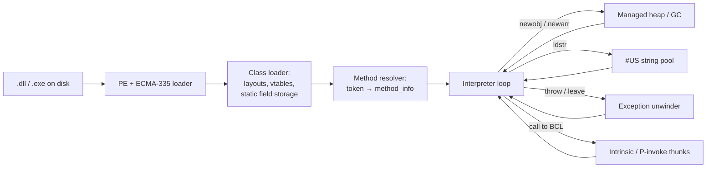
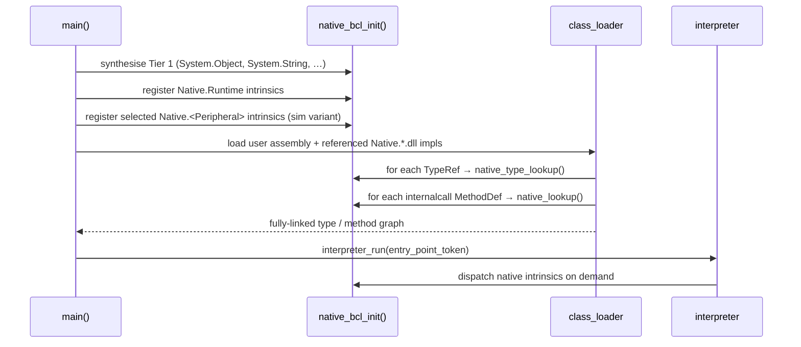

# Building an IL Virtual Execution Engine — Introduction

This document introduces the work required to turn the current **ECMA-335
metadata parser** into a **virtual execution engine (VEE)** capable of running
a .NET assembly by **interpreting CIL/IL bytecode directly** (no JIT
compilation, no native code emission).

The target is a self-contained, portable interpreter that:

- Loads a PE/CLI assembly (already implemented).
- Resolves types, methods, fields and signatures (largely implemented).
- Executes the entry-point method by walking the IL stream one opcode at a
  time, using a software evaluation stack and managed object heap.

---

## 1. What already exists

The current codebase ends at the "loaded and decoded" stage — it produces an
in-memory representation of everything the runtime needs, but does not yet
execute anything.

### 1.1 Parser layers (working)

| Layer                | Files                                                                                 | Purpose                                                                 |
|----------------------|---------------------------------------------------------------------------------------|-------------------------------------------------------------------------|
| PE loader            | [pe_parser.c](../source/pe_parser.c), [pe_parser.h](../source/pe_parser.h)            | DOS/PE/COFF headers, CLR header (COM descriptor), RVA→file translation. |
| Metadata root        | [ecma_335_parser.c](../source/ecma_335_parser.c)                                      | `BSJB` signature, streams `#~`, `#Strings`, `#Blob`, `#GUID`, `#US`.    |
| Table dispatcher     | [metadata_table.c](../source/metadata_table.c)                                        | Row iterator, coded-index sizing, compressed-int decoding.              |
| Row decoders (×27)   | [source/row_table/](../source/row_table)                                              | One `<table>_table.c` per implemented metadata table.                   |
| Signature decoder    | [signature_parser.c](../source/methods/signature_parser.c)                            | `Type`, method sig, field sig, `LOCAL_SIG`, `MemberRef` sig.            |
| Method body reader   | [method_parser.c](../source/methods/method_parser.c)                                  | Tiny/Fat headers, `local_var_sig_tok`, IL bytes.                        |
| Cross-table linking  | [typedef_parser.c](../source/methods/typedef_parser.c), `member_ref_parser.c`, ...    | Field/Method → TypeDef; MemberRef → parent.                             |
| Framework primitives | [source/framework/](../source/framework)                                              | Pool allocator (working), stack + object + exception + arch (stubs).    |

### 1.2 Metadata tables — decoder status

Implemented (see [parser_table_data.h](../source/row_table/parser_table_data.h)):
`Module (0x00)`, `TypeRef (0x01)`, `TypeDef (0x02)`, `Field (0x04)`,
`MethodDef (0x06)`, `Param (0x08)`, `InterfaceImpl (0x09)`,
`MemberRef (0x0A)`, `Constant (0x0B)`, `CustomAttribute (0x0C)`,
`ClassLayout (0x0F)`, `FieldLayout (0x10)`, `StandAloneSig (0x11)`,
`PropertyMap (0x15)`, `Property (0x17)`, `MethodSemantics (0x18)`,
`MethodImpl (0x19)`, `ModuleRef (0x1A)`, `TypeSpec (0x1B)`,
`FieldRVA (0x1D)`, `Assembly (0x20)`, `AssemblyRef (0x23)`,
`File (0x26)`, `NestedClass (0x29)`, `GenericParam (0x2A)`,
`MethodSpec (0x2B)`.

Missing (currently `NULL` decoders — required before execution):

| Table                          | Why the interpreter needs it                                   |
|--------------------------------|----------------------------------------------------------------|
| `FieldMarshal (0x0D)`          | P/Invoke and interop marshalling of parameters.                |
| `DeclSecurity (0x0E)`          | Optional — CAS metadata; can be skipped for a first release.   |
| `EventMap (0x12)` / `Event (0x14)` | Event add/remove/raise dispatch via `MethodSemantics`.       |
| `ImplMap (0x1C)`               | **Required** for any `pinvokeimpl` method.                     |
| `ExportedType (0x27)`          | Multi-file assemblies (rare — can be deferred).                |
| `ManifestResource (0x28)`      | `Assembly.GetManifestResourceStream` and embedded blobs.       |
| `GenericParamConstraint (0x2C)`| Generic constraint checking (deferrable if generics are v2).   |

### 1.3 Framework primitives — status

| Module                                                                                        | State        | Note                                                                    |
|-----------------------------------------------------------------------------------------------|--------------|-------------------------------------------------------------------------|
| [pool.c](../source/framework/pool.c)                                                          | Complete     | Fixed-size block allocator + queue mgmt — usable as the GC's back-end.  |
| [critical_section.c](../source/framework/critical_section.c)                                  | Complete     | Reentrancy guard.                                                       |
| [stack.h](../source/framework/stack.h), [stack.c](../source/framework/stack.c)                | **Stub**     | `stack_push/pop/peek_at` are empty; must be implemented for the VES.    |
| [objects.h](../source/framework/objects.h), [objects.c](../source/framework/objects.c)        | **Stub**     | `objects.c` is empty; needs full object model + allocator.              |
| [exception.h](../source/framework/exception.h)                                                | **Stub**     | `DO_ASSERT` disabled; will host managed-exception unwind.               |
| [arch.h](../source/framework/arch.h)                                                          | Skeleton     | `n_ptr_t`, `HEAP_ATTR`, `FRAME_ATTR` — hooks for a target port.         |

---

## 2. Target execution model

We follow **ECMA-335 Partition I §12** (Common Language Infrastructure —
Execution Model) and **Partition III** (CIL Instruction Set) literally, without
any JIT step.



The interpreter is a classic `while (running) { opcode = *ip++; switch(opcode)
{ ... } }` loop over a per-method **activation frame** containing:

- argument slots (`this` + declared params, promoted to stack-native widths),
- local slots (zero-initialised when `CorILMethod_InitLocals` is set),
- an evaluation stack sized by `MaxStack`,
- a saved IP and a return slot,
- a link to the enclosing exception-handler chain.

Each **evaluation-stack slot** is a tagged union — required because CIL is not
statically typed at the byte level (§III.1.1 "types on the evaluation stack":
`int32`, `int64`, `native int`, `F` (float), `O` (object ref), `&` (managed
pointer)). The skeleton for this already exists in
[stack.h](../source/framework/stack.h) as `stack_node_t` (`type[2]`,
`object[4]`).

---

## 3. Gap analysis — what still has to be built

Grouped by subsystem. Order roughly matches the recommended implementation
sequence.

### 3.1 Loader completion

1. **Fill in the six missing table decoders** listed in §1.2. Follow the
   step-by-step recipe in
   [docs-archive/Adding_Table_Decoder.md](../docs-archive/Adding_Table_Decoder.md).
2. **Exception-handling clause parser.** The fat method header can be followed
   by one or more sections (small/fat EH format, §II.25.4.5). Currently
   [method_parser_get_info](../source/methods/method_parser.c) reads the IL
   bytes but ignores everything after `code_size`. Add:
   - a decoder for `CorILMethod_Sect_EHTable` (small: 12 bytes, fat: 24 bytes
     per clause),
   - a `try_block_t { try_off, try_len, handler_off, handler_len, kind,
     class_token_or_filter_off }` array on `method_info_t`.
3. **`#US` (user-string) heap accessor.** Add
   `ecma_335_get_user_string(ctx, index, uint32_t * out_char_count)` returning
   the UTF-16 payload — needed by `ldstr`.
4. **`FieldRVA` bootstrap.** For each row, resolve the RVA to a pointer inside
   the mapped image so that `RuntimeHelpers.InitializeArray` (or its
   equivalent intrinsic) can `memcpy` from it.

### 3.2 Class / type system

Detailed background lives in
[Virtual_Method_Tables.md](../docs-archive/Virtual_Method_Tables.md) and
[TypeDef_Method_Traversal.md](../docs-archive/TypeDef_Method_Traversal.md).

1. **Instance layout computer.** For each `TypeDef`, compute:
   - total instance size (auto-layout from field signatures; explicit layout
     from `ClassLayout` + `FieldLayout`),
   - per-field offset table,
   - packing / alignment rules (`ClassLayout.PackingSize`).
2. **Static field storage.** Allocate one slab per type for `static` fields;
   initialise on first use by invoking the type's `.cctor` (lazy class init).
3. **vtable builder.** As described in the archive: copy parent vtable, replace
   slots for `virtual` methods that are **not** `newslot`, append new slots
   for `virtual newslot`. Store on a `method_table_t` referenced from every
   object header.
4. **Interface dispatch table.** For each interface a type implements
   (`InterfaceImpl`), store a mapping `iface_slot → concrete_method` so
   `callvirt` on an interface method is O(1).
5. **Token resolver.** A single entry point:
   `resolved_t resolve_token(uint32_t token)` returning a `method_info_t *`,
   `field_info_t *`, `type_info_t *`, or a `#US` handle depending on the top
   byte (see §II.22 token encoding). Should be called eagerly once per
   opcode use and the result cached in a per-method side table so the hot
   loop never re-walks metadata.
6. **Generics — minimum viable subset.** Substitute `VAR`/`MVAR` at method
   entry using instantiation vectors captured from `TypeSpec` /
   `MethodSpec`. Full shared-code generics can wait; a naive
   copy-per-instantiation is fine for v1.

### 3.3 Managed heap and object model

Currently only skeletons in [objects.h](../source/framework/objects.h).

1. **Object header** (`object_header_t`): `method_table_t *`, sync-block
   placeholder, then inline fields.
2. **Allocator.** Simplest workable choice: **bump-pointer nursery + arena** on
   top of the existing pool. A precise mark-and-sweep can be added later; the
   pool's queue infrastructure already gives you free-list plumbing.
3. **String type.** `System.String` instances are UTF-16 with a leading
   `int32` length. Populate via `ldstr` from the `#US` heap and by
   `String.Concat`-style intrinsics.
4. **Array type.** `SZARRAY`: `method_table_t *` + `int32 length` + element
   payload. `ARRAY` (multi-dim): also `int32 rank + sizes[] + lobounds[]`.
5. **Boxing.** Wrapping a value type into an object requires allocating an
   object whose payload copies the value; unboxing is a pointer into that
   payload. Implement `box`, `unbox`, `unbox.any`.

### 3.4 The interpreter core

1. **Evaluation stack — implementation of [stack.c](../source/framework/stack.c).**
   Replace the empty function bodies. Slot layout: `{ uint8_t kind;
   uint8_t reserved; uint32_t type_token; union { int32/int64/float/double/ptr }; }`.
2. **Activation frame.** One heap-allocated (from a pool) struct per active
   method call, chained via `prev_frame` to form the managed call stack.
3. **Dispatch table.** A `void * op_handlers[256]` (plus a second table for
   `0xFE xx` opcodes) works for computed-goto builds; a plain `switch` is
   equally fine and more portable.
4. **Opcode handlers.** Roughly 220 opcodes total; group them:
   - **Load/store/dup/pop** — `ldarg*`, `ldloc*`, `starg*`, `stloc*`, `dup`,
     `pop`, `ldc.*`, `ldnull`, `ldstr`, `ldtoken`.
   - **Arithmetic & logic** — `add`, `sub`, `mul`, `div`, `rem`, `neg`,
     `and`, `or`, `xor`, `shl`, `shr[.un]`, `not`, `*.ovf[.un]`.
   - **Conversions** — `conv.*` and `conv.ovf.*[.un]` (30+ opcodes).
   - **Compare & branch** — `ceq`, `cgt[.un]`, `clt[.un]`, `br[.s]`,
     `brfalse/brtrue[.s]`, `beq/bne/bge/bgt/ble/blt[.s][.un]`, `switch`.
   - **Method dispatch** — `call`, `callvirt`, `calli`, `newobj`, `ret`,
     `jmp`, `ldftn`, `ldvirtftn`.
   - **Fields** — `ldfld`, `ldflda`, `stfld`, `ldsfld`, `ldsflda`, `stsfld`.
   - **Objects & arrays** — `newarr`, `ldlen`, `ldelem*`, `stelem*`,
     `ldelema`, `box`, `unbox[.any]`, `castclass`, `isinst`,
     `initobj`, `ldobj`, `stobj`, `cpobj`.
   - **Indirect access** — `ldind.*`, `stind.*`, `cpblk`, `initblk`,
     `localloc`.
   - **Exceptions** — `throw`, `rethrow`, `leave[.s]`, `endfinally`,
     `endfilter`.
   - **Prefixes** — `unaligned.`, `volatile.`, `tail.`, `constrained.`,
     `readonly.`, `no.` (mostly ignorable for a correctness-first
     interpreter, but the prefix bytes must be consumed).
5. **Stack-slot type coercion.** Enforce §III.1.5: `int8/int16/bool/char`
   are promoted to `int32` on the stack; `float32` is promoted to `F`
   (machine-choice precision). Do the widening in the load opcode, the
   narrowing in the store opcode.

### 3.5 Exception handling

Once §3.1.2 parses the EH clauses:

1. On `throw`, walk up the frame chain looking for an enclosing `catch`
   whose class matches (via runtime `isinst`) or a `filter` that evaluates
   truthy. `finally`/`fault` clauses on the way are executed and then
   `endfinally` resumes the walk.
2. `leave` from a protected region runs all pending `finally` blocks in
   reverse and then transfers to the target IP.
3. Reuse the existing `exception.h` `KERNEL_TRY`/`KERNEL_RAISE_ERROR` hooks
   so the **host** can also longjmp out of a runaway interpreter.

### 3.6 Bridge to the outside world

You cannot execute any real assembly without at least a handful of BCL
methods. Two mechanisms:

1. **Internal calls (intrinsics).** A name-based dispatch table keyed on
   `Namespace.Type::Method` returning a C function pointer. Minimum useful
   set: `System.Console::WriteLine (int32|string|…)`,
   `System.String::Concat/Length/get_Chars`, `System.Object::ToString`,
   `System.Environment::Exit`, `System.Runtime.CompilerServices.RuntimeHelpers::InitializeArray`,
   `System.Buffer::BlockCopy`.
2. **P/Invoke** via `ImplMap`: `dlopen`/`GetProcAddress` the target library
   and marshal arguments per `FieldMarshal`. Optional for v1.

These are only the entry points. The full architecture — how the C side
declares its intrinsics, how the mandatory `System.*` floor is satisfied
without shipping a desktop-scale BCL, how per-peripheral `Native.*`
assemblies are structured as reference/implementation pairs so the same
user binary runs against a desktop simulator or (as future work) against
an STM32H7 HAL, and how the GC and the native code negotiate object
lifetimes — is developed in **§6 (External native APIs — the `Native.*`
assembly family)**.

### 3.7 Entry-point bootstrap

`entry_point_token` is already captured on `ecma_file_t`. The bootstrap:

```text
main()
├── pe_parser + ecma_335_parser           (done)
├── class_loader_run(ecma_file)           (§3.2)
├── heap_init()                           (§3.3)
├── method = resolve_token(entry_point_token)
├── frame = frame_new(method)
├── if method takes string[] args: build managed string[] from argv
├── interpreter_run(frame)                (§3.4)
└── return frame->return_value.i32
```

---

## 4. Recommended phased plan

Each phase produces a runnable milestone.

| Phase | Milestone                                                     | Deliverable test-case                                        |
|-------|---------------------------------------------------------------|--------------------------------------------------------------|
| 0     | Finish missing table decoders (§3.1.1) + EH parser (§3.1.2)   | Load a fat-header method with `try/catch` without warnings.  |
| 1     | Class loader + layouts + vtables (§3.2)                       | Dump a full class hierarchy with resolved vtable slots.      |
| 2     | Stack, frame, heap primitives (§3.3, §3.4.1–§3.4.2)           | Allocate, push/pop, call a no-op method that just `ret`s.    |
| 3     | Arithmetic + branches + locals + args                         | Run a static method that computes `fib(20)` and returns.     |
| **4** | **Native BCL bridge foundations (§6)**                        | **Parser-synthesised `System.Object..ctor` + `Native.Console.WriteLine("hi")` bound to C via `Native.Uart` sim impl — no IL decoded for either.** |
| 5     | Objects, fields, `newobj`, `callvirt`                         | Instantiate a class, call a virtual method that reads a field. |
| 6     | Strings, arrays, `ldstr`, `newarr`, `ldelem/stelem`           | "Hello, world" running end-to-end through the phase-4 intrinsic. |
| 7     | Exception handling (§3.5)                                     | `try/catch/finally` around a `throw new Exception(...)`.     |
| 8     | Generics minimum viable subset (§3.2.6)                       | Instantiate and use `List<int>`-shaped code.                 |
| 9     | P/Invoke + `ImplMap` (§3.6.2)                                 | Call a `libc` function through `pinvokeimpl`.                |

---

## 5. Reference material inside the repo

| Topic                          | Document                                                                 |
|--------------------------------|--------------------------------------------------------------------------|
| Adding a new table decoder     | [docs-archive/Adding_Table_Decoder.md](../docs-archive/Adding_Table_Decoder.md) |
| A worked table example         | [docs-archive/Module_Table_Definition.md](../docs-archive/Module_Table_Definition.md) |
| Signature blob format          | [docs-archive/Signature_Decoding.md](../docs-archive/Signature_Decoding.md), [docs-archive/signature_draft.md](../docs-archive/signature_draft.md) |
| Navigating decoded types       | [docs-archive/Navigating_Decoded_Types.md](../docs-archive/Navigating_Decoded_Types.md) |
| Method body & type traversal   | [docs-archive/TypeDef_Method_Traversal.md](../docs-archive/TypeDef_Method_Traversal.md) |
| vtable construction & dispatch | [docs-archive/Virtual_Method_Tables.md](../docs-archive/Virtual_Method_Tables.md) |
| Pool allocator API             | [docs-archive/Pool_Allocator.md](../docs-archive/Pool_Allocator.md)      |
| Full CLI spec                  | `docs-archive/ECMA-335_6th_edition_june_2012.pdf`                        |

Suggested reading in the ECMA-335 spec for the execution work:

- **Partition I §8–§12** — Common Type System and execution model.
- **Partition II §22–§25** — Metadata physical layout (already implemented).
- **Partition III §1–§4** — CIL instruction semantics (the interpreter core).
- **Partition III §1.5** — Types on the evaluation stack.
- **Partition II §25.4** — Method header and exception-clause encoding.

---

## 6. External native APIs — the `Native.*` assembly family

The .NET Base Class Library exists in two very different tiers as far as
this VEE is concerned:

**Tier 1 — the mandatory `System.*` floor.**
The C# compiler *requires* a fixed set of types before it will emit any
IL at all: `System.Object`, `System.ValueType`, `System.Enum`,
`System.Void`, every primitive from `System.Int32` through `System.Double`,
`System.String`, `System.Array`, `System.Delegate`,
`System.MulticastDelegate`, `System.Type`,
`System.Runtime{Type,Field,Method}Handle`, `System.Attribute` plus a
handful of well-known attributes, `System.Exception`, and
`System.Runtime.CompilerServices.RuntimeHelpers`. Every method signature
refers to at least `System.Void`, every reference type inherits
`System.Object`, every string literal materialises a `System.String`, and
any `throw` expression targets `System.Exception`. This tier is
non-negotiable.

**Tier 2 — the "real" API surface.**
Everything the *program* actually calls: hardware peripherals on the
microcontroller, host services on the desktop simulator, higher-level
utilities like `Math` or `Buffer`. On CoreCLR this tier is bundled into
the same `System.Private.CoreLib.dll` as Tier 1; on this VEE it is split
into a family of small `Native.*` assemblies. `System.IO.File`,
`System.Console`, `System.Threading.Thread`, and the rest of the
desktop-flavoured `System.*` API are *deliberately absent* — a
microcontroller has GPIO and I²C, not a filesystem full of files or a
threading model with cooperative scheduling.

The design goals for this section are therefore:

1. Satisfy Tier 1 with the smallest possible amount of code, all backed
   by C. No IL is decoded for `System.Object..ctor`, `System.String`
   accessors, or any other Tier 1 method.
2. Expose Tier 2 through explicit, per-peripheral `Native.*` assemblies
   so embedded users see one assembly per bus/peripheral and can pick
   exactly what they need.
3. Ship every Tier 2 assembly as a **ref/impl pair** so the same C#
   binary runs unchanged against a desktop simulator (impl calls
   stdio / stubs) and — as a follow-up project — against an STM32H7
   target (impl calls the STM32Cube HAL).
4. Allow the parser to **synthesise the Tier 1 floor internally** when
   no `Native.CoreLib.dll` is present on disk, so the earliest test
   cases can run with zero managed dependencies.

The rest of this section reviews the architectural options, evaluates
the alternatives, and recommends a concrete design. A full walkthrough
of the assembly matrix, the ref-assembly auto-generator, the
per-peripheral simulator behaviour, and the deferred STM32H7 work lives
in the companion document
[10_Native_Assembly_Layout.md](10_Native_Assembly_Layout.md).

### 6.1 Four architectural options

**Option A — Per-method intrinsics** (the CoreCLR *InternalCall* / *FCall* /
*QCall* model).
The managed side declares a normal method with an empty body and the
`InternalCall` implementation flag (§II.23.1.11:
`MethodImpl.ImplFlags & 0x1000`). At load time the runtime looks up the
method in a `name → C-function` table and stores the C pointer on the
`method_info_t`. IL is never decoded for that method.

- *Pros* — fine-grained; standard, well-understood contract; the same
  managed assembly runs on CoreCLR and on our VEE without changes.
- *Cons* — the managed metadata still has to exist and be loaded.

**Option B — Whole-type substitution / parser-synthesised types**
("native class descriptor").
Selected type references resolve to a **C-defined class descriptor**
instead of a managed `TypeDef`. Layout, vtable, and every method body
live entirely in C. In this codebase Option B has a second use: the
parser can synthesise the mandatory Tier 1 floor purely in C, so the
interpreter starts up correctly *even when no `Native.CoreLib.dll` is
present on disk* — invaluable for unit tests and self-hosting bring-up.

- *Pros* — fastest possible; no metadata cost per method; layout fully
  under C's control (critical for `Object`, `String`, `Array` where the
  GC and the interpreter both need exact field positions); works with
  zero managed dependencies.
- *Cons* — reflection surface is diminished; managed code cannot
  subclass or override these types cleanly; each substituted type has
  to be hand-written.

**Option C — Facade / stub assembly.**
Ship a tiny assembly (`Native.CoreLib.dll`, `Native.Gpio.dll`, …) where
every method is marked `internalcall` and the class hierarchy mirrors
the target API. The interpreter always finds metadata to bind against;
the C table provides all the code.

- *Pros* — clean separation; can be autogenerated from the C
  registration table; reflection over the API surface still works.
- *Cons* — build-time step to produce the stub; slightly more metadata
  to parse at startup.

**Option D — Reference/implementation split** (the .NET Core pattern).
For each Tier 2 assembly ship **two** variants: a *ref assembly*
(`ref/Native.Gpio.dll`) with empty bodies used at `csc /r` compile time,
and one or more *impl assemblies*
(`impl/sim/Native.Gpio.dll`, `impl/stm32h7/Native.Gpio.dll`) loaded by
the VEE at run time. Both variants publish the same `MethodDef` rows;
only the C bindings behind the `internalcall`s differ.

- *Pros* — the same user binary runs unchanged against desktop
  simulator and STM32H7 HAL impls; ref assemblies can be autogenerated
  from a C header describing the peripheral surface.
- *Cons* — two DLLs per API to build and version.

### 6.2 Recommended design — hybrid B + C + D layered on A

| Layer                                             | Strategy      | Assembly / types                                                                                        |
|---------------------------------------------------|---------------|--------------------------------------------------------------------------------------------------------|
| Tier 1 mandatory floor (compile-time requirement) | **B**         | `System.Object`, `System.ValueType`, `System.Enum`, primitives, `System.String`, `System.Array`, `System.Delegate`, `System.Exception`, `System.Type`, well-known attributes. Parser-synthesised in C by default; a `Native.CoreLib.dll` shim may add reflection metadata for the same types when loaded. |
| Tier 2 runtime services (target-independent)      | **A + C**     | `Native.Runtime` — GC hints, timing, `RuntimeHelpers.InitializeArray`, reboot/halt.                    |
| Tier 2 hardware surface (target-dependent)        | **A + C + D** | `Native.Gpio`, `Native.I2c`, `Native.Spi`, `Native.Adc`, `Native.Pwm`, `Native.Uart`, `Native.Timer`. Ref for `csc /r`; sim + (future) STM32H7 impls behind identical stubs. |
| Convenience wrappers                              | **C + IL**    | `Native.Console` = thin IL over `Native.Uart` (target) or `Native.Runtime.HostIo` (sim).               |
| Everything else                                   | pure IL       | User libraries; managed helpers that never touch hardware.                                             |

Rationale:

- **B** is unavoidable for the Tier 1 floor: nothing else can allocate
  a `System.String` because the interpreter and GC must agree on its
  exact layout. Parser-synthesised descriptors also make Tier 1
  available *before* any assembly is loaded, which is a hard bootstrap
  requirement.
- **C** provides the metadata anchor for Tier 2 without hand-writing
  stub metadata for every method — one generator emits ref assemblies
  from a C header.
- **D** decouples "what the compiler sees" from "what runs on the
  target", which is exactly the desktop-simulator ↔ STM32H7 story the
  project is chasing.
- **A** is the calling convention every intrinsic obeys once bound,
  regardless of tier. There is only one binding API in
  `framework/native_bcl.h`.

### 6.3 The `Native.*` assembly family

| Assembly          | Purpose                                                                                | Ref assembly? | Simulator impl                    | STM32H7 impl (future)             |
|-------------------|----------------------------------------------------------------------------------------|---------------|-----------------------------------|-----------------------------------|
| `Native.CoreLib`  | Optional reflection shim over the Tier 1 parser-synthesised floor. All methods `internalcall`; the C bindings are the same functions the parser installs when synthesising the types from thin air. | No — always identical  | Loaded only when reflection over `System.*` is needed | Same                              |
| `Native.Runtime`  | Cross-cutting VEE services: `RuntimeHelpers.InitializeArray`, timing, GC hints, reboot/halt, host I/O for the sim. | Yes           | `clock_gettime`, `atexit`, `stdin`/`stdout` | `HAL_GetTick`, `NVIC_SystemReset` |
| `Native.Gpio`     | Digital pin read/write, pin mode, edge callbacks.                                      | Yes           | stdout logger                     | `HAL_GPIO_*`                      |
| `Native.I2c`      | I²C master transactions.                                                               | Yes           | scripted-response table           | `HAL_I2C_Master_*`                |
| `Native.Spi`      | SPI full-duplex transfers.                                                             | Yes           | loopback                          | `HAL_SPI_TransmitReceive`         |
| `Native.Uart`     | Blocking + async UART read/write.                                                      | Yes           | host stdin/stdout                 | `HAL_UART_*`                      |
| `Native.Adc`      | Single-shot + continuous ADC reads.                                                    | Yes           | ramp / recorded-CSV               | `HAL_ADC_*`                       |
| `Native.Pwm`      | PWM channel config + duty cycle.                                                       | Yes           | logger                            | `HAL_TIM_PWM_*`                   |
| `Native.Timer`    | Software timers, periodic callbacks.                                                   | Yes           | pthread-based                     | `HAL_TIM_Base_*` + NVIC IRQ       |
| `Native.Console`  | Convenience `WriteLine` / `Write` / `ReadLine` over `Native.Uart` or `Native.Runtime.HostIo`. Pure IL, no `internalcall`. | Yes           | Yes                               | Yes                               |

Naming rule: every assembly whose implementation is (partly or wholly)
provided by C uses the `Native.` prefix. The `System.*` namespace is
reserved for Tier 1 only, and even then the parser-side descriptors are
authoritative — the on-disk `Native.CoreLib.dll` is an *additive*
reflection layer, never a replacement.

### 6.4 Reference/implementation split

Every Tier 2 `Native.*` assembly ships as:

- One **ref assembly** at `ref/Native.<Peripheral>.dll`.
  Full metadata, empty method bodies (`throw null;`). Used by `csc /r`
  when the user builds their C# program. Auto-generated from a C
  header — see [10_Native_Assembly_Layout.md](10_Native_Assembly_Layout.md).
- One or more **impl assemblies** at
  `impl/<target>/Native.<Peripheral>.dll`. Same public metadata; every
  method body is `internalcall`. Different `<target>` directories
  (`sim/`, `stm32h7/`, …) share the same managed metadata but bind to
  different C libraries.

At runtime the VEE loads *one* impl variant per assembly. The choice is
a launch flag on the simulator and a compile-time constant on
embedded targets. `AssemblyRef` rows in the user assembly refer to the
ref assembly's identity (name, version, public-key token); the loader
resolves them to the currently selected impl.

### 6.5 In scope: simulator. Future project: STM32H7 target

**In scope — desktop simulator (`sim/` impls).**
The VEE runs as a normal desktop process. Every `Native.<Peripheral>.dll`
has a `sim/` impl that maps peripheral operations onto host services:

- `Native.Gpio` writes → stdout log lines like `[GPIO] PA5 = HIGH`.
- `Native.Uart` reads/writes → stdin/stdout of the host process.
- `Native.I2c` / `Native.Spi` → scriptable transaction tables loaded
  from a JSON file at boot, so tests can pre-record slave responses.
- `Native.Adc` → ramp / sine / recorded-CSV generator.
- `Native.Timer` → pthread-based periodic callbacks.

This is enough to exercise almost all embedded application logic
without any hardware in the loop. It is what the Phase 4 "Native BCL
bridge foundations" milestone builds first, and it is the only impl
variant this repository ships.

**Out of scope, deferred to a follow-up project — STM32H7 target
(`stm32h7/` impls + AOT).**
The same C# binary flashed to an STM32H7 board runs against `stm32h7/`
impls that call the STM32Cube HAL directly. Two additional layers are
required in that future project and are *not* part of the current
roadmap:

1. **AOT compilation.** Interpretation is too slow for hard-real-time
   control loops on the target. A follow-up project will emit ARM
   Thumb-2 machine code (Cortex-M7 profile) for the hot IL — either
   ahead-of-time on the desktop and burned into flash, or lazily on
   first execution using a small on-device compiler. This is
   explicitly *not* attempted here; the current VEE is
   interpreter-only.
2. **HAL wiring.** Each `stm32h7/Native.*.dll` impl replaces the sim's
   stdio/logging with `HAL_GPIO_*`, `HAL_UART_*`, `HAL_I2C_*`, etc.
   The C headers that auto-generate the ref assemblies are the same
   in both cases; only the binding table differs.

The reference/implementation split (Option D) is designed precisely so
that this transition costs *zero* recompilation of the user's C# code.

### 6.6 Binding API sketch

Two small headers, one for method intrinsics, one for type substitutions:

```c
/* framework/native_bcl.h */

/* Uniform C prototype every intrinsic obeys. */
typedef void (*native_intrinsic_fn)(vee_thread_t   * thread,
                                    stack_node_t   * args,     /* len == arg_count */
                                    uint32_t         arg_count,
                                    stack_node_t   * ret);     /* NULL when void */

typedef struct native_intrinsic_desc_t
{
    const char * assembly;      /* "Native.Gpio"; NULL matches any assembly */
    const char * namespace_;    /* "Native.Gpio" or "System" for the Tier 1 floor */
    const char * type_name;     /* "Pin" */
    const char * method_name;   /* "WriteDigital" */
    const char * signature;     /* ILAsm-style; disambiguates overloads */
    native_intrinsic_fn fn;
} native_intrinsic_desc_t;

void                vee_native_register(const native_intrinsic_desc_t * table,
                                        uint32_t count);
native_intrinsic_fn vee_native_lookup(const methoddef_table_decoded_t * m,
                                      const typedef_table_decoded_t   * declaring);

/* Whole-type substitution — used for the Tier 1 System.* floor and for
   any hardware type whose layout the C side needs to control. */
typedef struct native_type_desc_t
{
    const char * namespace_;
    const char * type_name;
    uint32_t     instance_size;
    uint32_t     instance_align;
    void      (*build_method_table)(struct method_table_t * out);
    void      (*static_ctor)(void);           /* optional; replaces .cctor */
} native_type_desc_t;

void vee_native_type_register(const native_type_desc_t * table, uint32_t count);
```

Registration happens **before** the class loader runs:

```c
int main(int argc, char ** argv)
{
    native_bcl_init();                    /* Tier 1 synthesis + intrinsic tables */
    ecma_file_t * asm_ = load_pe_and_metadata(argv[1]);
    class_loader_run(asm_);               /* sees native tables during layout */
    interpreter_run(asm_->entry_point);
}
```

### 6.7 Detecting an "internal call" method

The class loader marks a method as native-implemented when any of:

- `method->ImplFlags & 0x1000` (`miInternalCall`), or
- `method->ImplFlags & 0x1000` combined with `RVA == 0` — runtime-provided
  method such as `Delegate.Invoke`, or
- the declaring type resolves to a registered native type (in which
  case *every* method is native).

A `MethodDef` whose `RVA == 0` but which is neither `internalcall`,
`abstract`, nor `pinvokeimpl` is malformed and should be rejected at
load.

### 6.8 Marshalling — evaluation stack ↔ C arguments

Two policies, applied per intrinsic:

1. **Uniform prototype** (default). Every intrinsic receives an `args[]`
   array. Argument N is on `args[N]`; `this` (if any) is `args[0]`.
   Cheap and universal.

   ```c
   static void nat_Math_Sqrt(vee_thread_t * t,
                             stack_node_t * args, uint32_t n,
                             stack_node_t * ret)
   {
       ret->kind = STACK_F8;
       ret->u.d_value = sqrt(args[0].u.d_value);
   }
   ```

2. **Typed thunk** (opt-in, code-generated). For the top ~20 hottest
   intrinsics we can afford a hand-written thunk that reads the stack
   slots directly into native argument registers. Roughly 30 % faster
   on short calls; more code to maintain.

Type promotion rules (§III.1.5) apply at the boundary: `bool`, `int8`,
`int16`, `char` all arrive as `int32`; `float32` arrives as `F`
(double). The intrinsic writer must obey the same rules on the way
back into `ret`.

### 6.9 GC and object-lifetime interop

Contract the C side must respect:

1. **Arguments live at least until the intrinsic returns.** The
   evaluation stack roots them; C can dereference `args[i].u.o_ref`
   freely.
2. **Freshly allocated objects are unrooted the moment C returns**
   unless they end up in `*ret` (which the interpreter roots on push)
   or are stored into an already-rooted field.
3. **All object-typed writes go through a write barrier**:
   `vee_gc_write_ref(void ** slot, void * new_ref)`. Direct assignment
   is a bug the day a moving / generational GC arrives.
4. **Buffers handed to syscalls must be pinned.** `vee_array_pin(arr)`
   returns a raw `void *` valid until the matching
   `vee_array_unpin(arr)`. The pin must be released before the
   intrinsic returns.
5. **Long-lived native handles** (file descriptors on the sim, DMA
   channels on hardware) are owned by C. Their managed wrapper
   (`Native.I2c.Bus`, `Native.Uart.Port`, …) carries an opaque
   `IntPtr` field that only the C side interprets.
6. **Peripheral state is C-owned and singleton per instance.** Each
   peripheral (a specific GPIO port, I²C bus, timer channel) is
   represented on the managed side by a small class carrying an
   integer index or an opaque handle. The C impl keeps its own table
   of active peripheral states; the managed object may be GC'd at any
   time — the C state persists across GC cycles and is torn down only
   via explicit `Dispose`/`Close`, which the C impl maps to a
   peripheral `Deinit`.

### 6.10 Bootstrapping order



Tier 1 synthesis happens *before* any assembly is opened, so the first
`TypeRef` resolution for `System.Object` already finds a valid
descriptor even if no `.dll` file exists for it. The `Native.CoreLib`
shim, when loaded, adds reflection metadata *on top* of these
descriptors — it never redefines them.

Which `Native.<Peripheral>` intrinsic tables are registered is decided
by the host program (`main.c` on the sim, `Src/main.c` on the future
STM32H7 build), not by the interpreter — see §6.13.

### 6.11 Worked example — `Native.Gpio.Pin.WriteDigital(bool)`

**Ref assembly** (`ref/Native.Gpio.dll`, seen by `csc /r`):

```csharp
namespace Native.Gpio {
    public sealed class Pin {
        public Pin(int port, int number) { throw null; }
        public void WriteDigital(bool level) { throw null; }
        public bool ReadDigital()           { throw null; }
        public void SetMode(PinMode m)      { throw null; }
    }
    public enum PinMode { Input, Output, InputPullUp, InputPullDown }
}
```

**Impl assembly** (`impl/sim/Native.Gpio.dll`, loaded by the VEE):

Identical metadata, but every method body is:

```text
.method public hidebysig instance void WriteDigital(bool level)
    cil managed internalcall { }
```

**C binding** (`framework/native_gpio_sim.c` in the desktop build):

```c
static void nat_Gpio_Pin_WriteDigital(vee_thread_t * t,
                                      stack_node_t * args, uint32_t n,
                                      stack_node_t * ret)
{
    /* args[0] = this (managed Pin), args[1] = level (bool → int32) */
    gpio_pin_t * self = (gpio_pin_t *)args[0].u.o_ref;
    int level = args[1].u.i32_value & 1;

    printf("[GPIO] P%c%u = %s\n",
           'A' + self->port, self->number, level ? "HIGH" : "LOW");
}

static const native_intrinsic_desc_t gpio_intrinsics[] =
{
    { "Native.Gpio", "Native.Gpio", "Pin", "WriteDigital", "void(bool)",
      nat_Gpio_Pin_WriteDigital },
    { "Native.Gpio", "Native.Gpio", "Pin", "ReadDigital",  "bool()",
      nat_Gpio_Pin_ReadDigital  },
    { "Native.Gpio", "Native.Gpio", "Pin", "SetMode",
      "void(valuetype Native.Gpio.PinMode)",
      nat_Gpio_Pin_SetMode      },
};

void native_gpio_sim_register(void)
{
    vee_native_register(gpio_intrinsics,
                        sizeof(gpio_intrinsics) / sizeof(gpio_intrinsics[0]));
}
```

The (future) STM32H7 build will ship `framework/native_gpio_stm32h7.c`
with the same `gpio_intrinsics[]` table pointing at C functions that
call `HAL_GPIO_WritePin` / `HAL_GPIO_ReadPin` instead. The user's
`.exe` is byte-identical between the two builds.

At execution, when the interpreter reaches
`callvirt void Native.Gpio.Pin::WriteDigital(bool)` it resolves the
token to a `method_info_t` whose `native_impl` pointer is set, pops the
argument slots, invokes the C function, and continues. No IL is decoded
for `WriteDigital`.

### 6.12 Impact on the class loader (§3.2)

Three hooks to add during class-loading:

1. **Tier 1 pre-population.** Before opening any assembly, install the
   synthesised `System.*` descriptors via
   `vee_native_type_register`. Subsequent `TypeRef` resolution for
   those types must be O(1) and side-effect-free.
2. Before decoding a `TypeRef`, consult
   `vee_native_type_lookup(namespace, name)`. If present, install the
   C descriptor directly; skip resolution into the target assembly.
3. When linking each `MethodDef`, check `ImplFlags & miInternalCall`;
   if set, call `vee_native_lookup` and store the result on
   `method_info_t.native_impl`. If not found, mark the method as
   *unlinked-internalcall* and defer the error to first invocation, so
   dead code paths do not prevent load.

These are the only structural changes; the rest of the design lives in
`framework/native_bcl.{c,h}` and per-topic intrinsic files
(`native_corelib.c`, `native_runtime.c`, `native_gpio_sim.c`,
`native_i2c_sim.c`, `native_uart_sim.c`, …).

### 6.13 Security and sandboxing

- Registration is the *only* channel through which native code becomes
  reachable from managed code. A build that omits
  `native_gpio_sim_register()` cannot toggle any GPIO even if malicious
  IL declares `internalcall` methods with those exact names.
- Peripheral capabilities compose. A locked-down sensor-only build
  registers only `Native.Adc` and read-only `Native.I2c`; actuator
  APIs like `Native.Gpio` and `Native.Pwm` are simply absent from the
  symbol table.
- Optional strict mode: match resolved `internalcall` methods against
  the strong name / public key of their declaring assembly and reject
  mismatches.
- Never expose a raw `dlopen` / `GetProcAddress` intrinsic without a
  policy layer above it — that would collapse the whole sandbox.

### 6.14 Estimated payoff

Back-of-envelope on a modern x86-64 CPU; the interpreter numbers assume
a switch-based dispatch loop with ~10 ns per opcode.

| Workload                             | Pure interp  | + Native BCL | Speed-up      |
|--------------------------------------|--------------|--------------|---------------|
| `Math.Sqrt` in a tight loop          | ~500 ns/call | ~15 ns/call  | ~30×          |
| `String.Concat(a, b)` (~10 char)     | ~5 μs        | ~80 ns       | ~60×          |
| `Array.Copy` (1 KB)                  | ~50 μs       | ~200 ns      | ~250×         |
| `Native.Gpio.Pin.WriteDigital` (sim) | n/a          | ~100 ns      | syscall-bound |

Intrinsifying the ~100 hottest BCL methods typically recovers most of
the gap between a pure interpreter and a JIT for compute-heavy
workloads, while keeping the runtime itself in portable C. The same
lever is what makes hardware I/O usable at all — an interpreted GPIO
write costing microseconds is unacceptable for anything with a
bit-bang protocol.

### 6.15 Conclusions

- **Two tiers, one binding API.** The Tier 1 `System.*` floor and the
  Tier 2 `Native.*` API surface look very different on paper but share
  the same C-side registration, lookup, and dispatch code
  (`vee_native_register` / `vee_native_lookup`).
- **`Native.*` names what it is.** The `System.*` namespace is
  reserved for the mandatory language floor; anything else — including
  peripherals, timing, and console I/O — lives under `Native.*`. This
  prevents the "grow-a-desktop-BCL" drift that eventually swallows
  every embedded runtime.
- **Ref/impl split is what makes the target migration cheap.** The
  desktop simulator and the (future) STM32H7 target expose the same
  metadata; only the C bindings differ. The user's `.exe` is
  byte-identical between the two builds.
- **Parser-synthesised Tier 1 unblocks bring-up.** The interpreter
  runs its first tests before any `Native.CoreLib.dll` exists; the
  reflection shim is additive, never required.
- **Do it early.** The bridge is not an optimisation layered on top
  of a working interpreter — it is a prerequisite. Every simplest
  managed program calls into `Object..ctor`, materialises a
  `System.String`, or writes to some peripheral. Phase 4 in the
  roadmap therefore builds the bridge scaffolding immediately after
  the interpreter can execute basic arithmetic.
- **The GC contract is the sharpest edge.** Every intrinsic writer
  must learn the six rules in §6.9. A misuse there manifests as
  random memory corruption weeks later. Enforce it with a mandatory
  `vee_gc_*` API and static-analysis (or code-review) discipline.
- **STM32H7 execution is a follow-up project.** The current work
  produces a working desktop simulator with the full `Native.*`
  matrix; ARM Thumb-2 AOT compilation and the STM32Cube HAL bindings
  are explicitly deferred.

---

## 7. Next-document plan

This introduction stays at overview level. Follow-up documents that should
land in this `doc/` folder as the design solidifies:

- `01_Class_Loader.md` — instance/static layout, vtable & interface tables.
- `02_Managed_Heap.md` — object header, allocator, GC strategy.
- `03_Evaluation_Stack_and_Frames.md` — slot format, frame chaining.
- `04_Interpreter_Dispatch.md` — opcode grouping, decoder helpers.
- `05_Exception_Handling.md` — EH-clause parsing and unwind.
- `06_Intrinsics_and_PInvoke.md` — BCL surface, `ImplMap`, marshalling.
- `07_Generics.md` — signature substitution and instantiation caches.
- `08_Bootstrap_and_Testing.md` — entry-point, argv handling, test harness.
- `09_Native_BCL_Bridge.md` — the design detailed in §6: registration API,
  intrinsic conventions, type-substitution, GC interop, and the concrete
  set of C files that ship with the runtime (`native_corelib.c`,
  `native_runtime.c`, `native_string.c`, `native_array.c`, `native_math.c`).
- `10_Native_Assembly_Layout.md` — the `Native.*` assembly matrix, the
  reference/implementation split, the ref-assembly auto-generator, the
  simulator per-peripheral behaviour, the parser-synthesised Tier 1
  floor, and the follow-up work required to target STM32H7 with AOT
  compilation.
