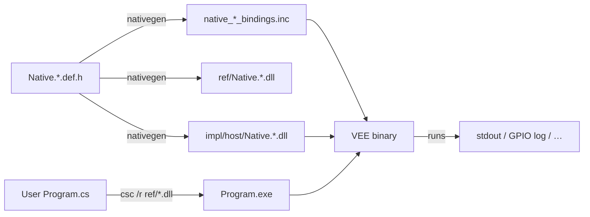
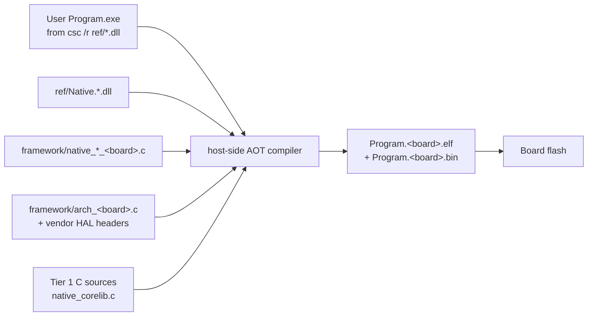

# The `Native.*` assembly family — layout, build, and bindings

Companion detail for §6 of [00_Introduction.md](00_Introduction.md).

This document covers:

- the exact assembly matrix and directory layout,
- the parser-synthesised Tier 1 `System.*` floor,
- the reference/implementation split (ref for `csc /r`, impl for the VEE),
- the ref-assembly auto-generator,
- the per-peripheral host behaviour,
- how a user project is built and packaged,
- the follow-up work required to target one or more embedded boards via
  host-side AOT compilation.

`00_Introduction.md` chose the high-level architecture (hybrid B + C + D
layered on A) and named the assemblies; this document is what a
contributor needs before touching any of the code.

---

## 1. Two-tier model recap

| Tier | Contents | Where the metadata lives | Where the code lives |
|------|----------|--------------------------|----------------------|
| 1    | Mandatory `System.*` floor required by the C# compiler | Parser-synthesised at VEE startup, optionally shadowed by an on-disk `Native.CoreLib.dll` for reflection | 100 % C, in `framework/native_corelib.c` |
| 2    | Runtime services + hardware peripherals + convenience wrappers | `Native.*.dll` ref/impl assemblies on disk | Impl-specific C files under `framework/native_*_<target>.c`, plus pure IL for convenience wrappers |

The Tier 1 floor is *always* present. Tier 2 is opt-in per assembly —
a build that never wants to touch GPIO simply omits
`native_gpio_host_register()` from `main.c`.

---

## 2. Directory layout

```
runtime/
├── framework/                          # C code — the VEE itself
│   ├── native_bcl.h / native_bcl.c     # registration + lookup infrastructure
│   ├── native_corelib.c                # Tier 1: System.Object/String/Array/…
│   ├── native_runtime_host.c            # Tier 2 target-independent (host variant)
│   ├── native_gpio_host.c
│   ├── native_i2c_host.c
│   ├── native_spi_host.c
│   ├── native_uart_host.c
│   ├── native_adc_host.c
│   ├── native_pwm_host.c
│   ├── native_timer_host.c
│   ├── native_console_host.c            # optional; convenience wrapper impl
│   └── platform/                       # OS abstraction — the ONLY OS-specific code
│       ├── platform_stdio.h            # portable stdin/stdout/stderr surface
│       ├── platform_thread.h           # pthread / win-thread abstraction
│       ├── platform_clock.h            # monotonic clock + sleep + high-res timers
│       ├── platform_fs.h               # DLL search, config file load (host target only)
│       ├── linux/                      # POSIX backends: posix_stdio.c, pthread_thread.c, …
│       ├── windows/                    # Win32 backends: win_stdio.c, win_thread.c, …
│       └── macos/                      # (POSIX reuses linux/; only macOS-specific bits here)
│
├── native-assemblies/                  # managed side — one dir per assembly
│   ├── Native.CoreLib/
│   │   ├── ref/                        # (empty — Tier 1 has no ref shim yet)
│   │   └── impl/                       # optional reflection shim
│   ├── Native.Runtime/
│   │   ├── ref/                        # emitted by nativegen
│   │   └── impl/                       # emitted by nativegen — every method internalcall
│   ├── Native.Gpio/
│   │   ├── ref/
│   │   └── impl/
│   ├── Native.I2c/
│   ├── Native.Spi/
│   ├── Native.Uart/
│   ├── Native.Adc/
│   ├── Native.Pwm/
│   ├── Native.Timer/
│   └── Native.Console/
│       ├── ref/
│       └── impl/                       # real IL bodies over Native.Uart / HostIo
│
├── tools/
│   └── nativegen/                      # C-header → ILAsm → ref+impl DLL generator
│
└── build/
    ├── ref/                            # published output: what csc /r sees
    │   ├── Native.Runtime.dll
    │   ├── Native.Gpio.dll
    │   └── …
    └── impl/
        └── host/                        # loaded by the desktop VEE at run time
            ├── Native.Runtime.dll
            ├── Native.Gpio.dll
            └── …
```

Every assembly has its own directory even when the ref side is empty.
That makes the ref/impl split explicit at the filesystem level and lets
a future embedded-board tree slot straight in.

Embedded board targets do **not** appear under `build/impl/` — they do
not load DLLs at run time. Their C bindings live alongside the host ones
in `framework/` (e.g. `native_gpio_stm32h7.c`, `native_gpio_esp32.c`)
and are consumed at *link* time by the host-side AOT toolchain described
in §9. `build/impl/<board>/` does not exist because there is nothing to
put in it.

**OS abstraction is mandatory, not optional.** The `framework/platform/`
subtree is the **only** place in the codebase where OS-specific code
lives. Every other C file in `framework/` compiles on any C99 toolchain with
the standard library alone. This separation exists so:

- The host target runs unchanged on Linux, macOS, and Windows.
- The same abstraction survives verbatim on a hosted embedded target
  (a Linux-hosted Cortex-A board, a QEMU harness, a Zephyr shim).
- On bare-metal targets the platform layer is stubbed out
  (`platform_thread.h` becomes a header-only no-op, `platform_fs.h`
  disappears entirely) rather than #ifdef'd inside every source file.

Every `native_*_host.c` calls **only** the `platform_*.h` surface — never
`pthread_create`, `clock_gettime`, `CreateFileW`, or similar directly.
Any code review that spots a raw OS symbol outside `framework/platform/`
is a defect.

> **Terminology.** Two distinct axes both once used the word "host":
> `framework/platform/` abstracts **which OS** the build runs on, while
> **host** as a *target* (`native_*_host.c`, `build/impl/host/`) means
> the developer's computer as opposed to an MCU board. The word
> "simulator" is deliberately avoided throughout: nothing here emulates
> a target CPU or its peripherals. The host target is the same C source
> compiled natively, with `Native.*` bound to OS services.

---

## 3. Tier 1 — parser-synthesised `System.*` floor

### 3.1 Which types are synthesised

The Tier 1 floor is exactly the set of types the C# compiler cannot
compile without. Each is registered from
`framework/native_corelib.c` via
`native_type_register` **before** the class loader touches any
assembly:

| Type                                                   | Kind          | Notes |
|--------------------------------------------------------|---------------|-------|
| `System.Object`                                        | ref, root     | Header layout owned by C. |
| `System.ValueType`                                     | ref, abstract | Parent of every struct.  |
| `System.Enum`                                          | ref, abstract | Parent of every enum.    |
| `System.Void`                                          | valuetype     | Zero-size sentinel.      |
| `System.Boolean`, `System.Char`, `System.SByte`, `System.Byte`, `System.Int16`, `System.UInt16`, `System.Int32`, `System.UInt32`, `System.Int64`, `System.UInt64`, `System.Single`, `System.Double`, `System.IntPtr`, `System.UIntPtr` | valuetype | Layout fixed by the interpreter. |
| `System.String`                                        | ref           | UTF-16 payload with `int32` length prefix; layout owned by C. |
| `System.Array`                                         | ref, abstract | Parent of every `SZARRAY`/`ARRAY`. |
| `System.Delegate` + `System.MulticastDelegate`         | ref           | Trailing invocation list built by the runtime. |
| `System.Type`, `System.RuntimeTypeHandle`, `System.RuntimeFieldHandle`, `System.RuntimeMethodHandle` | mixed | `ldtoken` targets. |
| `System.Attribute` + well-known attributes             | ref           | `DebuggableAttribute`, `CompilationRelaxationsAttribute`, `RuntimeCompatibilityAttribute`. Empty impls suffice. |
| `System.Exception`                                     | ref           | Message/StackTrace layout owned by C so the unwinder can walk it. |
| `System.Runtime.CompilerServices.RuntimeHelpers`       | static        | Hosts `InitializeArray` bridging to `FieldRVA.Data`. |

Everything else — `List<T>`, `StringBuilder`, `Dictionary<,>`,
`Encoding`, etc. — is *not* Tier 1. If a user program wants it, they
ship pure IL for it or bind it to C themselves.

### 3.2 What the parser installs

For each Tier 1 type the parser installs a `native_type_desc_t`:

- `namespace_` = `"System"`, `type_name` = e.g. `"String"`.
- `instance_size` / `instance_align` from a table hand-derived from
  ECMA-335 §I.8 layout rules.
- `build_method_table(out)` populates the C-owned vtable with function
  pointers into `native_corelib.c` implementations (`Object..ctor`,
  `Object.GetHashCode`, `Object.Equals`, `Object.ToString`,
  `String.get_Length`, `String.get_Chars`, …).
- `static_ctor` is used only for the primitive `Type` singletons that
  need to be materialised eagerly.

The class loader's Tier 1 pre-population hook (`§6.12` item 1) walks
this table before opening any assembly, so the first `TypeRef` a
subsequent assembly emits for `System.Object` already resolves to the
C descriptor.

### 3.3 Optional `Native.CoreLib.dll` reflection shim

When present, `Native.CoreLib.dll` provides *reflection metadata* over
the exact same types. Its `MethodDef` rows are all `internalcall`; the
resolver looks up the same C functions the parser already installed
during Tier 1 synthesis. The shim exists only so managed code can call
`typeof(int).Name` or iterate `Assembly.GetTypes()` — it never
introduces new types or new bodies.

An interpreter build that never uses reflection can omit the shim
entirely; Tier 1 continues to work.

---

## 4. Tier 2 — the `Native.*` assembly matrix

Cross-reference with `00_Introduction.md` §6.3. Deeper detail per
assembly:

### 4.1 `Native.Runtime`

Target-independent runtime services. Everything the interpreter itself
needs to expose to managed code that is *not* peripheral-specific.

```csharp
namespace Native.Runtime {
    public static class Clock {
        public static long UptimeMicroseconds { get { throw null; } }
        public static void Sleep(int microseconds) { throw null; }
    }
    public static class Gc {
        public static void Collect()                      { throw null; }
        public static void SuppressFinalize(object obj)   { throw null; }
    }
    public static class System {
        public static void Reboot()                       { throw null; }
        public static void Halt(int exitCode)             { throw null; }
    }
    public static class HostIo {                          /* host only */
        public static int ReadByte()                      { throw null; }
        public static void WriteByte(byte b)              { throw null; }
    }
    public static class Interop {                         /* used by Native.CoreLib */
        public static unsafe void InitializeArray(object array, IntPtr fieldHandle) { throw null; }
    }
}
```

Host impl backs each method with `clock_gettime`, `usleep`, `_exit`,
`stdin`/`stdout`, and `memcpy` from `FieldRVA.Data`.

### 4.2 `Native.Gpio`

One `Pin` class carrying `(port, number)`. All operations single-pin
for now; batch APIs land later if profiling shows they are needed.

```csharp
namespace Native.Gpio {
    public enum PinMode { Input, Output, InputPullUp, InputPullDown, OpenDrain }
    public enum Edge    { None, Rising, Falling, Both }

    public sealed class Pin {
        public Pin(int port, int number)              { throw null; }
        public void SetMode(PinMode mode)             { throw null; }
        public void WriteDigital(bool level)          { throw null; }
        public bool ReadDigital()                     { throw null; }
        public void RegisterCallback(Edge edge, Action<Pin> handler) { throw null; }
    }
}
```

Host impl: `WriteDigital` logs to stdout; `ReadDigital` returns a value
from a scripted table (default: last written value); callbacks fire
from a helper thread when the scripted table produces a transition.

### 4.3 `Native.I2c`

Bus is the addressable unit; each transaction is a
write-then-optionally-read sequence.

```csharp
namespace Native.I2c {
    public sealed class Bus {
        public Bus(int index, int speedHz)            { throw null; }
        public void Write(byte address, byte[] data)  { throw null; }
        public byte[] Read(byte address, int length)  { throw null; }
        public byte[] WriteRead(byte address, byte[] write, int readLength) { throw null; }
    }
}
```

Host impl reads a JSON file at boot describing per-address canned
responses; a mismatched write triggers a hard fault so tests catch
protocol regressions immediately.

### 4.4 `Native.Spi`

Full-duplex master. Chip-select handled by the caller via `Native.Gpio`.

```csharp
namespace Native.Spi {
    public enum Mode { Mode0, Mode1, Mode2, Mode3 }
    public sealed class Master {
        public Master(int index, int speedHz, Mode mode) { throw null; }
        public void TransmitReceive(byte[] tx, byte[] rx) { throw null; }
    }
}
```

Host impl defaults to loopback (`rx[i] = tx[i]`) and can also load a
scripted response file.

### 4.5 `Native.Uart`

Blocking + async byte streams.

```csharp
namespace Native.Uart {
    public sealed class Port {
        public Port(int index, int baudRate)          { throw null; }
        public void Write(byte[] data)                { throw null; }
        public int Read(byte[] buffer, int timeoutMs) { throw null; }
        public event Action<Port, byte[]> DataReceived;
    }
}
```

Host impl: port 0 maps to host stdin/stdout; other indices raise
`NotSupportedException`.

### 4.6 `Native.Adc`

Single-shot and continuous.

```csharp
namespace Native.Adc {
    public sealed class Channel {
        public Channel(int index, int resolutionBits) { throw null; }
        public int ReadRaw()                          { throw null; }
        public double ReadVoltage(double vref)        { throw null; }
        public void StartContinuous(Action<int> handler, int samplesPerSecond) { throw null; }
        public void Stop()                            { throw null; }
    }
}
```

Host impl: ramp generator by default; can be swapped for a CSV replay
generator via boot config.

### 4.7 `Native.Pwm`

Frequency + duty cycle.

```csharp
namespace Native.Pwm {
    public sealed class Channel {
        public Channel(int timer, int channel)        { throw null; }
        public void Configure(int frequencyHz, double dutyCycle) { throw null; }
        public void Start() { throw null; }
        public void Stop()  { throw null; }
    }
}
```

Host impl logs each configuration change and does nothing at Start/Stop.

### 4.8 `Native.Timer`

Software / hardware timer abstraction. Periodic callback into managed
code.

```csharp
namespace Native.Timer {
    public sealed class Periodic {
        public Periodic(int intervalMicroseconds, Action handler) { throw null; }
        public void Start()                                        { throw null; }
        public void Stop()                                         { throw null; }
    }
}
```

Host impl uses a dedicated pthread that sleeps and calls back.

### 4.9 `Native.Console`

Only pure-IL assembly in the family; ships one impl variant. Depends
on `Native.Uart` on the target, `Native.Runtime.HostIo` on the host.

```csharp
namespace Native.Console {
    public static class Out {
        public static void Write(string s)     { /* IL body */ }
        public static void WriteLine(string s) { /* IL body */ }
        public static void WriteLine()         { /* IL body */ }
    }
    public static class In {
        public static string ReadLine()        { /* IL body */ }
    }
}
```

A build config chooses which backend `Native.Console` binds to; the
user's code always says `Native.Console.Out.WriteLine("hi")`.

---

## 5. Reference/implementation split — mechanics

### 5.1 What lives in each half

| Aspect                    | Ref assembly (`ref/`)                         | Impl assembly (`impl/<target>/`)                          |
|---------------------------|-----------------------------------------------|-----------------------------------------------------------|
| Public types              | Every public type present                     | Same set, same names                                      |
| Public method signatures  | Same as impl                                  | Same as ref                                               |
| Method bodies             | `ldnull throw` (i.e. `throw null;`)           | `internalcall` (or IL for convenience assemblies)         |
| Custom attributes         | `ReferenceAssemblyAttribute`                  | None                                                      |
| Assembly identity         | Name + version + PKT match ref & impl         | Same                                                      |
| Used by                   | `csc /r ref/…`                                | Loaded by the VEE at runtime                              |

Because the identities match, `AssemblyRef` rows the C# compiler
writes into the user's `.exe` bind cleanly to whichever impl variant
the runtime loads.

### 5.2 The `nativegen` tool

`tools/nativegen` accepts a small C header describing the peripheral
surface and emits both DLLs. Example input:

```c
/* native-assemblies/Native.Gpio/native_gpio.def.h */

NATIVE_ASSEMBLY("Native.Gpio", "1.0.0.0")

NATIVE_ENUM("Native.Gpio", "PinMode",
    "Input",
    "Output",
    "InputPullUp",
    "InputPullDown",
    "OpenDrain")

NATIVE_ENUM("Native.Gpio", "Edge",
    "None", "Rising", "Falling", "Both")

NATIVE_CLASS("Native.Gpio", "Pin",
    NATIVE_CTOR("void(int32, int32)", nat_Gpio_Pin_ctor),
    NATIVE_METHOD("SetMode",       "void(valuetype Native.Gpio.PinMode)", nat_Gpio_Pin_SetMode),
    NATIVE_METHOD("WriteDigital",  "void(bool)",  nat_Gpio_Pin_WriteDigital),
    NATIVE_METHOD("ReadDigital",   "bool()",      nat_Gpio_Pin_ReadDigital),
    NATIVE_METHOD("RegisterCallback",
        "void(valuetype Native.Gpio.Edge, class [Native.CoreLib]System.Action`1<class Native.Gpio.Pin>)",
        nat_Gpio_Pin_RegisterCallback))
```

Running the generator produces:

- `native-assemblies/Native.Gpio/ref/Native.Gpio.il`
- `native-assemblies/Native.Gpio/impl/Native.Gpio.il`
- `framework/native_gpio_bindings.inc` — the
  `native_intrinsic_desc_t` table already populated with pointers to
  the C function names in the header.

`ilasm` then produces the two DLLs. The C impl author writes only the
function bodies:

```c
/* framework/native_gpio_host.c */

#include "native_gpio_bindings.inc"    /* generated */

/* implementations ------------------------------------------------- */
void nat_Gpio_Pin_ctor(...)          { ... }
void nat_Gpio_Pin_SetMode(...)       { ... }
void nat_Gpio_Pin_WriteDigital(...)  { ... }
/* etc. */

void native_gpio_host_register(void)
{
    native_register(gpio_intrinsics,            /* from generated header */
                    NATIVE_GPIO_COUNT);
}
```

The generator is idempotent and produces deterministic output so build
diffs stay reviewable.

### 5.3 Selecting an impl variant at runtime

The host VEE loads impls by convention: `impl/host/` first. A launch
flag (`--native-impl-dir <path>`) overrides for smoke-testing.
`AssemblyRef` resolution walks the search directories in order and
picks the first hit whose (name, version, PKT) matches.

Embedded board targets **do not load DLLs at all**. The host-side AOT
toolchain (see §9) replaces run-time DLL loading with link-time
symbol resolution: `Native.*` metadata comes from the ref assemblies
as build inputs, and every `internalcall` binds to the corresponding
`native_*_<board>.c` C symbol during the final link. The device flash
image contains no PE files, no `#~` stream, no `AssemblyRef` walker —
only the C code the AOT step produced.

---

## 6. Host behaviour matrix

| Assembly          | Default host behaviour                            | Configurable via                                   |
|-------------------|--------------------------------------------------|----------------------------------------------------|
| `Native.Runtime`  | `clock_gettime`, `usleep`, host stdin/stdout     | Environment vars for time-warp factor              |
| `Native.Gpio`     | Write → stdout log; read → last-written value    | JSON pin-script file (`HOST_GPIO_SCRIPT`)           |
| `Native.I2c`      | Per-address canned responses; unknown = fault    | JSON transaction file (`HOST_I2C_SCRIPT`)           |
| `Native.Spi`      | Loopback                                         | JSON transaction file (`HOST_SPI_SCRIPT`)           |
| `Native.Uart`     | Port 0 = host stdio; others = `NotSupported`     | Optional Unix-socket redirection per port          |
| `Native.Adc`      | Ramp 0..MAX                                      | CSV replay file (`HOST_ADC_CSV`)                    |
| `Native.Pwm`      | Log only                                         | Optional VCD dump                                  |
| `Native.Timer`    | pthread with `nanosleep`                         | Time-warp factor shared with `Native.Runtime`      |
| `Native.Console`  | Wraps host stdio via `Native.Runtime.HostIo`     | —                                                  |

The JSON script and CSV formats are versioned; a top-level `"version"`
key lets `nativegen` emit example scripts that stay compatible as the
schema evolves.

---

## 7. Building and packaging a user project

End-to-end flow for a user shipping a C# program against the host:



1. Contributors write `Native.<Peripheral>.def.h` and its C
   implementation once.
2. `nativegen` produces ref/impl DLLs and the C bindings header.
3. Users compile their C# program with `csc /r build/ref/*.dll`,
   producing a plain `Program.exe`.
4. Users launch the VEE with `vee Program.exe`; the loader picks
   `build/impl/host/*.dll` for every referenced `Native.*`.

The user never touches `impl/`. Moving the same `Program.exe` to an
STM32H7 build would only require the `impl/stm32h7/` tree to exist —
no rebuild of `Program.exe`.

---

## 8. Testing strategy

- **Per-assembly unit tests** — a small C# fixture per `Native.*`
  exercises every public API against the host impl. Golden output for
  stdout-facing peripherals (`Native.Gpio`, `Native.Pwm`,
  `Native.Console`) is checked into the repo.
- **Integration fixtures** — one or two "real" C# programs
  (blink-with-callback, I²C sensor read) exercise multiple peripherals
  together and act as regression smoke tests.
- **Ref/impl consistency check** — `nativegen --check` diffs the ref
  and impl assemblies' public metadata; a mismatch fails the build
  before anything else runs.
- **Tier 1 conformance suite** — a hand-written IL program allocates a
  `System.String`, boxes/unboxes an `int32`, throws and catches an
  `Exception`, populates a static array via
  `RuntimeHelpers.InitializeArray`, and calls a virtual `Object`
  method. Runs against every VEE build.

Nothing here requires .NET runtime installed on the CI host — `ilasm`
alone (or the pre-built DLL fixtures under `data/`) is enough to
produce every test artefact.

---

## 9. Future work — host-side AOT for embedded board targets

Explicitly *not* part of the current project. Sketch only, so the
current design does not accidentally close off that path.

### 9.1 Scope — many boards, not one

The follow-up project generalises "the STM32H7 target" into **any
resource-constrained board target**. Every such target shares three
characteristics that the host build does not:

- No filesystem the VEE can load DLLs from at run time — the flash
  image is monolithic.
- No process model — one program per boot, `main()` runs forever.
- Fixed RAM + fixed flash budgets known at build time.

The candidate board list is open-ended; the following are indicative
rather than committed, and are used here only to make the constraint
tables concrete:

| Board family        | Core             | Flash    | RAM       | Notes                                     |
|---------------------|------------------|---------:|----------:|-------------------------------------------|
| STM32H7             | Cortex-M7        |     2 MB |     1 MB  | Reference target; hardest FPU/DMA case.   |
| STM32F4 / F7        | Cortex-M4 / M7   |   ≤ 2 MB |  ≤ 512 KB | Widely available, cheaper baseline.       |
| RP2040              | dual Cortex-M0+  |   varies |    264 KB | Second core could host peripheral driver. |
| ESP32-S3            | dual Xtensa LX7  |  ≤ 16 MB |    512 KB | Adds `Native.Wifi` / `Native.Ble`.        |
| nRF52840            | Cortex-M4        |     1 MB |    256 KB | BLE stack drives its own `Native.*`.      |

Each board defines a table of hard constraints — flash budget, RAM
budget, presence/absence of FPU, list of `Native.*` assemblies that
have a C impl — and the AOT toolchain refuses to produce a binary
that overflows any of them. Adding a new board is a matter of
dropping in `native_*_<board>.c` files and an entry in the board
manifest; no changes to the parser, the class loader, or the AOT
compiler itself are expected.

### 9.2 Deliverable shape — one self-contained binary per board

Unlike the host, embedded targets do not load `Native.*.dll` files at
run time. The AOT toolchain runs on the developer's host and folds
five inputs into one flashable image:



Consequences:

- **`Native.*` code is baked in.** The AOT step consumes the ref
  assemblies purely as metadata; every `internalcall` resolves to a
  direct C symbol at link time. The impl DLLs the host loads never
  ship to the device.
- **`AssemblyRef` resolution is a compile-time operation** on the
  target. The interpreter code paths that walk assembly search paths
  can be dropped from the target binary entirely — significant flash
  savings.
- **Reflection is opt-in per binary.** A build that wants
  `typeof(int).Name` compiles in the `Native.CoreLib` reflection
  shim's metadata tables; a build that does not, drops them. This is
  a per-binary switch, not a runtime toggle.

The host-side compiler is where the resources live — a laptop CPU has
orders of magnitude more time and memory to spend on optimisation
than the target does, and no need to fit the compiler itself into
flash.

### 9.3 AOT compiler design sketch

Host-side, single pass over the loaded metadata + IL:

1. **Enumerate reachable methods** starting from the entry point,
   following `call` / `callvirt` / `newobj` and vtable slot occupants.
2. **Emit Tier 1 as pre-written C.** `System.Object..ctor`,
   `System.String::get_Length`, etc. are already C functions in
   `native_corelib.c`; the AOT step just links them.
3. **Emit reachable IL methods as C.** Each IL method becomes a
   static C function with the interpreter's `stack_node_t` model
   lowered to plain C locals wherever the SSA form allows. This is
   a "C99 as portable assembly" pass — no attempt at register
   allocation or instruction selection; the target C compiler
   (`arm-none-eabi-gcc`, `xtensa-esp32s3-elf-gcc`,
   `riscv32-unknown-elf-gcc`, …) does the real code generation.
4. **Emit vtable + interface tables as `static const` arrays.**
5. **Emit string pool + `FieldRVA` payloads into `.rodata`.**
6. **Invoke the target C compiler** to produce the final ELF and BIN.

Advantages of routing through C rather than emitting Thumb-2 (or
Xtensa, RISC-V, …) directly:

- Zero back-end code in the AOT compiler itself.
- Any board whose vendor ships a working C toolchain is supported
  with no new work in this project.
- The generated code is human-readable — invaluable for on-target
  debugging with `arm-none-eabi-gdb`.

Drawback: no in-process JIT recompilation. Acceptable because the
whole model is host-side AOT; the target never compiles anything.

### 9.4 Constraints the current design already respects

- **All C code is portable ISO-C.** No Linux/POSIX-only calls in
  `framework/`; anything OS-specific is behind the
  [`framework/platform/`](#2-directory-layout) layer described in §2.
  That same abstraction survives verbatim on any hosted board target
  (a Linux-hosted QEMU harness, a Zephyr shim) and is stubbed out on
  bare-metal targets.
- **Every peripheral API is per-instance** (`Native.Gpio.Pin`,
  `Native.I2c.Bus`, `Native.Uart.Port`). No global "the GPIO
  controller" singleton — makes multi-instance targets (dual UART,
  three I²C buses) trivial and matches how real HAL drivers ship.
- **The pool allocator ([pool.c](../source/framework/pool.c)) is
  fixed-size block based**, which is friendly to a small heap and
  requires no memory-management OS support.
- **The evaluation-stack slot format (`stack_node_t`) fits four
  bytes of payload** — matches the 32-bit natural word width of
  every candidate board.
- **`native_intrinsic_desc_t` stores four pointers and one function
  pointer per entry.** A full `Native.*` matrix of ~200 methods
  costs ~4 KB on a 32-bit target — and the AOT build drops that cost
  entirely because `internalcall` resolution moves to link time.
- **The `Native.*` naming discipline holds on every target.** The
  `System.*` namespace never grows to admit peripherals — a common
  failure mode of embedded runtimes that try to look like a desktop
  BCL and end up implementing `System.IO.Ports.SerialPort` on top of
  a UART.

### 9.5 To be decided (deliberately deferred)

Three questions the follow-up project should answer before writing
any AOT code. The current project produces the data needed to answer
each.

1. **C-only end-to-end?** The single-binary AOT model argues strongly
   for C as the *only* implementation language on the target side:
   one toolchain per board, one intermediate representation, no
   embedded scripting language, no on-device compiler footprint.
   Consequences:

   - No second language (Rust, C++, …) inside `framework/`.
   - No language-specific runtime beside the VEE (`libunwind`,
     `libc++abi`).
   - The AOT compiler *itself* is a separate decision: it could be
     written in C (portable, self-contained, no bootstrap) or in C#
     bootstrapped through this interpreter (dogfoods the runtime,
     shorter development iterations). The output binary is
     C-only either way.

2. **Two products or one?** The current architecture already
   separates concerns cleanly:

   - The **interpreter is host-focused** — fast iteration, full
     reflection, unlimited RAM, OS services, throw-away runs.
   - The **AOT compiler is target-focused** — fixed flash, no
     filesystem, board HAL, single boot-to-`main()` model.

   These can ship as one binary with a `--target host|<board>` flag,
   or as two independent tools sharing this repository's parser and
   Tier 1 code. Either way, the split of *what runs where* is
   already decided: the interpreter never runs on the device, the
   AOT compiler never runs on the device.

3. **GC policy.** The tricolour mark-sweep over a handle heap specified
   in [11_Memory_Model.md](11_Memory_Model.md) and summarised in §3.3 of
   [00_Introduction.md](00_Introduction.md) fixes the *addressing* model
   — handles, not pointers, so compaction never needs pointer fixups —
   but deliberately leaves the *collection* policy open. The right
   answer depends on measurements the interpreter itself will produce —
   allocation rates, average object lifetime, peak live set,
   per-generation survival curves for representative workloads. Only
   once the host
   has hosted a real embedded application for long enough to
   characterise those numbers can the target GC be dimensioned.

   Candidate strategies span the full range:

   | Strategy                 | Fit                                                | Cost                          |
   |--------------------------|----------------------------------------------------|-------------------------------|
   | *No GC*                  | Long-lived objects only; simplest sensor firmware  | Zero, at the cost of leaks    |
   | *Reference counting*     | Predictable, no pauses; struggles with cycles      | Small per-write barrier       |
   | *Mark & sweep (STW)*     | Cheap RAM, occasional pauses                       | Pause proportional to live set|
   | *Mark & sweep + nursery* | Balanced; good survival curves for typical apps    | Two allocation paths          |
   | *Copying / compacting*   | Best allocation throughput; needs 2× heap headroom | Doubles RAM footprint         |

   The interpreter grows a `framework/gc.*` interface with a
   pluggable back-end so switching strategies later is a matter of
   swapping one C file — no changes to the class loader, the
   evaluation stack, or the intrinsic tables.

None of these decisions block the current host-target work.
The host exists in part to *generate the evidence* on which they
will be made.

---

## 10. Cross-references

- Introduction and roadmap — [00_Introduction.md](00_Introduction.md).
- §6 architectural decision (this doc's parent) —
  [00_Introduction.md §6](00_Introduction.md#6-external-native-apis--the-native-assembly-family).
- Adding a metadata table decoder —
  [../docs-archive/Adding_Table_Decoder.md](../docs-archive/Adding_Table_Decoder.md).
- vtable construction (referenced by Tier 1 `build_method_table`) —
  [../docs-archive/Virtual_Method_Tables.md](../docs-archive/Virtual_Method_Tables.md).
- Pool allocator (backs the small object heap) —
  [../docs-archive/Pool_Allocator.md](../docs-archive/Pool_Allocator.md).
- Existing FieldRVA bootstrap (source of `RuntimeHelpers.InitializeArray`
  payload) — [../source/row_table/fieldrva_table.c](../source/row_table/fieldrva_table.c).
